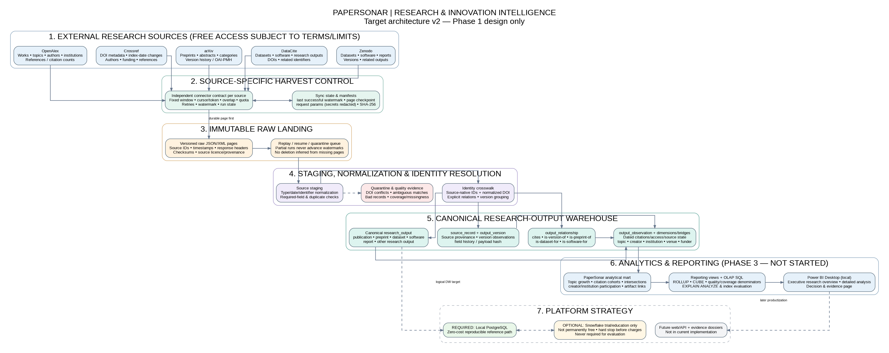

<p align="center"></p>

<p align="center">
  <b>Research & Innovation Intelligence Warehouse</b><br>
  <sub>Snowflake · strict ELT · five scholarly sources · reproducible analytics</sub>
</p>

<p align="center">
   
   
  
  
  
</p>

---

# PaperSonar

PaperSonar is a research-intelligence warehouse that connects scholarly
publications, preprints, datasets, research software, authors and creators,
institutions, venues, citations and related-output relationships. It exists to
answer one question honestly: **which research directions are worth attention,
and what evidence supports that claim?**

Every number in this repository is reproducible from committed SQL against a
live Snowflake account, and every number carries its denominator, its source
provenance and the evidence file that backs it. Where the data cannot support
a conclusion, the project says so instead of publishing one.

## At a glance

| | |
|---|---|
| Canonical research outputs | **296,299** across 5 published batches, 0 duplicate DOIs |
| Topic coverage | **74.40%** of outputs classified (1.92% before the Phase 3 taxonomy) |
| Taxonomy | 67 categories in 10 domains, 63 populated, one row per output and category |
| Relationship edges | 2,557,842 reference edges, 94,912 induced inside the corpus |
| Analytical questions | 14, every one executed live and exported as evidence |
| OLAP | `ROLLUP`, `CUBE` and `GROUPING SETS` with `GROUPING_ID` subtotal flags |
| Reporting layer | 5 `SECURE` views granted to a dedicated reporter role |
| Optimization | 4 statements measured before and after; clustering rejected and rolled back |
| Quality gate | 12 DQ rules, fail-closed publication, per-batch results |
| Automated tests | 270 passing, ruff clean, SQL parsed and contract-checked |

## The problem

A researcher can find any single paper. Comparing *possible* research
directions is much harder, because the evidence lives in five different
metadata services that disagree about subjects, dates, identifiers and
versions, and because every "trending topic" claim is really a claim about a
counting rule. PaperSonar turns those five services into one versioned,
source-provenanced output graph, and then applies explicit, published rules
for counting, coverage and suppression to every question it answers.

A sparse intersection is a signal worth watching, never proof of novelty.

## The live corpus

| Source | Batch | Published records | Topic coverage |
|---|---|---:|---:|
| OpenAlex | `BATCH_07D9668D4CBED88D815D30CA` | 168,725 | 98.30% |
| Crossref (small) | `BATCH_B51983B70B26023F22201AE2` | 18,495 | 35.30% |
| Crossref (DAB) | `BATCH_DAB12A7209208BE375D89C0B` | 60,000 | 35.30% |
| arXiv | `BATCH_3DF8101D66B0797A217FD877` | 15,505 | 100.00% |
| Zenodo | `BATCH_A75F9C61B9BF73B40CBC8C54` | 33,741 | 34.33% |

296,299 canonical outputs, 220,501 classified, 75,798 unclassified, 265,968
citation observations, 101,257 outputs with a resolved institution.

**The corpus is bimodal in time.** 78,226 institution-linked outputs are
stamped 2026 (the current extraction windows), a long tail sits before 2009,
and the 2021–2025 window that most topic questions need holds only a few
thousand works. Every year-scoped result therefore prints its denominator
next to its ratio, and every growth ranking is suppressed when either endpoint
has fewer than 30 works.

## Architecture



[PNG](docs/architecture/diagrams/07_Target_architecture_v2.png) · [PDF](docs/architecture/diagrams/07_Target_architecture_v2.pdf) · [SVG](docs/architecture/diagrams/07_Target_architecture_v2.svg) · [Architecture notes and logical model](docs/architecture/README.md)

```
five public sources
  → deterministic extraction (Python) → raw gzip NDJSON → internal stage + manifest
  → PROJECT_STAGING (COPY)      → PROJECT_BRONZE  (one row per source record id)
  → PROJECT_SILVER (typed observations, quarantine, identity crosswalk)
  → PROJECT_DW   (dimensions, facts, bridges, conformed keys)
  → PROJECT_REPORTING (publication-filtered SECURE views)
  → PROJECT_AUDIT (lifecycle, DQ, lineage) · PROJECT_REF (versioned taxonomy and rule contracts)
```

Python extracts and uploads raw gzip NDJSON only. Every transformation,
deduplication, identity resolution, category scoring, surrogate-key
assignment, quality gate and publication decision runs in Snowflake SQL. The
batch lifecycle is `EXTRACTING → LOADED → PROCESSING → PUBLISHED / FAILED`,
and watermarks advance only after a batch passes the gate.

## Five-source strategy

| Priority | Source | Main value | Incremental design |
|---:|---|---|---|
| 1 | [OpenAlex](https://api.openalex.org/) | Scholarly graph: works, authors, institutions, topics, sources, citation metadata | One-time full backfill; incremental uses `from_updated_date` (Member+/Partner daily sync required) |
| 2 | [Crossref](https://api.crossref.org/) | DOI bibliographic metadata and reindex changes | Fixed `from-index-date` / `until-index-date` windows with cursor paging and overlap |
| 3 | [arXiv](https://export.arxiv.org/api/query) | Computing preprints, categories, abstracts, versions | OAI-PMH datestamp windows; preserve version observations |
| 4 | [DataCite](https://api.datacite.org/) | Datasets, software and other registered research outputs | Public API updated-date query or OAI-PMH; validate update semantics |
| 5 | [Zenodo](https://zenodo.org/api/) | Datasets, software, reports, versions, related identifiers | OAI-PMH datestamp windows with API detail/backfill |

Do not add more sources until these five connectors have been individually
tested. Identities, API limits, update windows, provenance, overlap and
recovery rules: [source strategy](docs/sources.md) and the
[source capability matrix](docs/phase2/SOURCE_CAPABILITY_MATRIX.md).

## What Phase 3 delivered

| Work package | Deliverable | Evidence |
|---|---|---|
| WP1 — taxonomy | 67-category contract, reproducible categorization, one row per output and category, DQ-009 before/after | [`evidence/00_taxonomy/`](docs/phase3/evidence/00_taxonomy/WP1_TAXONOMY_EVIDENCE.md) · [runbook](docs/phase3/WP1_TAXONOMY_RUNBOOK.md) |
| WP2 — 14 questions | Q01–Q14 with explicit denominators, coverage and suppression rules | [`evidence/01_queries/`](docs/phase3/METRIC_CATALOGUE.md) · [catalogue](docs/phase3/METRIC_CATALOGUE.md) |
| WP3 — OLAP | `ROLLUP`, `CUBE`, `GROUPING SETS` with subtotal flags | [notes](docs/phase3/OLAP_NOTES.md) · [`evidence/02_olap/`](docs/phase3/evidence/02_olap/OLP1_rollup_category_year.csv) |
| WP4 — reporting views | 5 `SECURE` views granted to `PAPERSONAR_REPORTER` | [`sql/07_reporting/04_phase3_reporting_views.sql`](sql/07_reporting/04_phase3_reporting_views.sql) |
| WP5 — optimization | 4 statements measured before/after; clustering rejected, rolled back, negative result published | [report](docs/phase3/OPTIMIZATION_REPORT.md) · [`evidence/03_optimization/`](docs/phase3/evidence/03_optimization/BENCH_TIMINGS.csv) |
| WP6 — Power BI | Three-page specification with visuals, DAX measures and caveats | [spec](docs/phase3/POWERBI_SPEC.md) |
| WP7 — insights | Report, 5-page PDF, 8-slide deck, seven traceable findings | [report](docs/phase3/INSIGHTS_REPORT.md) · [PDF](docs/phase3/INSIGHTS_REPORT.pdf) · [deck](docs/phase3/INSIGHTS_DECK.pptx) |

## Findings worth reading before the numbers

1. **Coverage is a source property, not a contract property.** The v3
   taxonomy moved OpenAlex from 3.40% to 98.30% and arXiv to 100%, while
   Crossref reached 35.30% — because those Crossref records carry no subject
   field at all (49,093 records, 0 subjects). The honest ceiling is a source
   limit, and the report says so.
2. **Growth questions cannot be answered yet.** 389 works in 2023 and 1,053 in
   2025 make every ratio unstable, so the Phase 1 suppression rule is kept
   and the conclusion is "not yet reportable".
3. **The counting rule decides the leaderboard.** Under fractional allocation
   ecology overtakes botany and ai-ml falls from 4th to 11th. Both counts are
   published so the reader can see which rule produced which ranking.
4. **One identifier dominates the institution metric.** A single OpenAlex
   institution id holds 49,203 works — 56.9% of all institutional credit — and
   makes the physics-2026 top-5 concentration of 99.24% an artifact of the
   source metadata, not a statement about physics.
5. **Only three topic pairs are reportable** (ai-ml×health-sciences 10 joint
   works, health-sciences×law 9, ai-ml×physics 9). On a young taxonomy, a
   short pair list is the correct answer.
6. **Open access is 90.42% of known-status outputs**, with 39,183 outputs of
   unknown status reported separately rather than folded into either number.

Full detail with evidence paths: [Phase 3 insights report](docs/phase3/INSIGHTS_REPORT.md).

## Platform strategy and cost policy

One production target: **Snowflake**, accessed with key-pair authentication
through the official Python connector. There is no PostgreSQL, SQLite or
local-database fallback for ingestion; deterministic tests use a mocked
Snowflake adapter purely as a testing technique. Production runs must use a
currently available **no-cost** Snowflake trial/credits offer. Paid resources
are never activated, and if no no-cost offer is available, live deployment
stops and is reported as **BLOCKED** — never switched to another database.

The account runs one X-Small warehouse with 60-second auto-suspend, guarded
by a resource monitor, with the analytical layer marked `-- Deploy: manual`
so the deployment client never runs the 14 queries, the three OLAP analyses or
the benchmark by accident. Cost position and every measure applied:
[cost log](docs/phase3/COST_LOG.md). Setup and operating instructions:
[Phase 2 runbook](docs/phase2/RUNBOOK.md) and
[step-by-step Snowflake setup](docs/phase2/SNOWFLAKE_SETUP_STEP_BY_STEP.md).

## Course alignment

| Phase | Weight | State | Evidence |
|---|---:|---|---|
| Phase 1 | 30% | delivered | proposal, business requirements, 14 analytical questions, business processes, fact types and grains, dimensions, natural/surrogate keys, conceptual-logical-physical model, diagrams, data dictionary |
| Phase 2 | 40% | delivered, live-proven on 5 batches | source ingestion, `PROJECT_STAGING` / `PROJECT_DW` / `PROJECT_REPORTING`, cleaning and transformation, surrogate-key loads, DQ gate and publication views |
| Phase 3 | 30% | delivered | analytical SQL, `ROLLUP`/`CUBE`, five reporting views, measured optimization, Power BI specification, insight report and deck |

The lab's retail examples are not copied into PaperSonar: the same DWBI
techniques are implemented with research-output measures. The element-by-element
mapping is in [course mapping](docs/phase3/COURSE_MAPPING.md) and the
requirement-by-requirement traceability in the
[requirements matrix](docs/requirements/course-requirements-matrix.md).

## Repository map

**Phase 3 delivery**
- `docs/phase3/` — plan, status, metric catalogue, taxonomy runbook, OLAP notes, optimization report, Power BI spec, insights report (+ PDF, deck), course mapping, cost log
- `docs/phase3/evidence/` — `00_taxonomy/`, `01_queries/` (Q01–Q14 exports), `02_olap/` (OLP1–OLP3), `03_optimization/` (before/after artefacts and timings)

**Design and requirements**
- `docs/architecture/` — target architecture, logical model and the diagram set
- `docs/requirements/` — traceability matrix, incremental ingestion design, source verification log
- `docs/decisions/` — recorded architecture decisions, including the free-first platform choice
- `docs/sources.md` — five-source acquisition and incremental plan
- `docs/submissions/phase-1/` — original Phase 1 artifacts, retained for history

**Phase 2**
- `docs/phase2/spec/` — the 20-document implementation pack and the agent contract
- `docs/phase2/RUNBOOK.md` — operator runbook: setup, secrets, commands, recovery, troubleshooting
- `docs/phase2/IMPLEMENTATION_STATUS.md`, `ACCEPTANCE_REPORT.md`, `REPOSITORY_AUDIT.md`, `SOURCE_CAPABILITY_MATRIX.md`, `PIPELINE_FLOW_GUIDE.md`

**Code**
- `src/extract/` — five source adapters and the raw gzip NDJSON writer
- `src/runner/` — deterministic windows, Snowflake upload/manifest, CLI, SQL deployment
- `sql/00_setup/` … `sql/10_analytics/` — deployable strict-ELT SQL in layer order, plus the manual analytical layer
- `sql/99_tests/` — read-only acceptance evidence queries
- `scripts/` — taxonomy seed generator, insight artifact builder (PDF/deck)
- `tests/` — 270 unit, contract and SQL-guard tests
- `config/` — source registry, quality rules, taxonomy contract, corpus example

**Automation**
- `.github/workflows/extract-load.yml` — scheduled/manual extraction, upload and graph trigger
- `.github/workflows/deploy-ci.yml` — tested, reviewed SQL deployment through the internal stage

## How to run it

```bash
python -m pip install -e ".[dev]"     # dependencies
python -m pytest tests -q             # 270 tests
python -m ruff check src tests        # lint
python -m runner.cli deploy --sql-dir sql --yes   # deploy the SQL layer (admin role)
```

Deployment through GitHub Actions: **Actions → deploy-ci → Run workflow**,
branch `main`, confirmation input `DEPLOY`. Manual runs need the confirmation
input; pushes that touch `sql/**`, `config/**` or `src/runner/**` deploy
automatically after the test job. `sql/00_setup/` and every file marked
`-- Deploy: manual` are skipped by the client.

Regenerate the report artifacts after editing the insights report:

```bash
python scripts/build_insights_artifacts.py   # writes INSIGHTS_REPORT.pdf and INSIGHTS_DECK.pptx
```

## Known limits and blockers

Stated plainly, because a warehouse that hides its limits is not evidence.

- **OpenAlex incremental is blocked** by the source: `from_updated_date`
  requires a Member+/Partner plan and returns HTTP 403. The full backfill is
  live; the incremental path is not, and no fallback was invented.
- **DataCite is not live-proven.** Its three batches failed on two truncating
  columns, which are fixed and verified live
  (`VARCHAR(4000)`), and on extraction behaviour outside the project. The
  remaining blocker is the registry, not the code.
- **Topic coverage has a measured ceiling** of about 35% for Crossref and
  Zenodo, because those records carry no structured subject field.
- **The Power BI PBIX is not built**: the desktop client is outside the
  warehouse, so the deliverable is a complete three-page specification with
  visuals, DAX measures and caveats.
- **Affiliation metadata is sparse and skewed** — 101,257 outputs, all
  outside 2012–2025, with one identifier holding 56.9% of the credit.
- **The Snowflake trial is the binding constraint** on the remaining work: it
  ends around 2026-12-15 with roughly $328 of $400 in credits. Everything
  course-visible is therefore committed to the repository before the deadline.

## Roadmap

1. [x] Initial scope, publication-centered model and 20-record pilot.
2. [x] Five-source strategy and target architecture.
3. [x] Phase 2: strict-ELT extractors, current-state bronze, silver identity, dimensional model, DQ gate, publication views and task graph.
4. [x] Live multi-source ingestion: five published batches, 296,299 outputs.
5. [x] Phase 3: taxonomy, 14 analytical questions, OLAP, five reporting views, measured optimization, Power BI specification, insight report and deck.
6. [x] Account housekeeping and final delivery on `main`.
7. [ ] Re-test clustering when the relation fact passes ~25 million rows.
8. [ ] Publish the DataCite path once the registry serves a stable extraction window.
9. [ ] Build the PBIX from `docs/phase3/POWERBI_SPEC.md` on a desktop client.
10. [ ] Validate the direction-comparison workflow with real researchers.

## Licensing and evidence

The repository code licence does not automatically license external metadata
or linked full-text content. Retain source, licence/terms reference,
extraction time, source identifier, raw checksum and transformation version.
Full raw records, credentials, logs and database dumps stay out of Git. API
limits and source policies must be rechecked before implementation.

Every figure quoted in this README is backed by a committed evidence file
under `docs/phase3/evidence/`, and the live account state is summarised in
[Phase 3 status](docs/phase3/PHASE3_STATUS.md).
