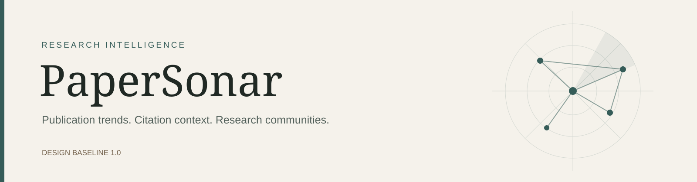
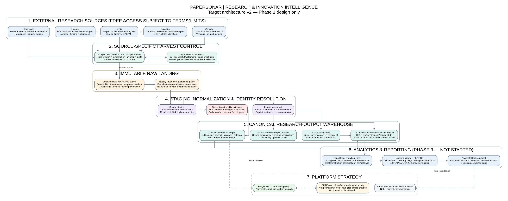

# PaperSonar

**Research & Innovation Intelligence Warehouse**

PaperSonar is a design-stage research intelligence platform that connects scholarly publications, preprints, datasets, research software, authors/creators, institutions, citations and related-output relationships. It is designed to help users compare research directions using transparent counts, dated observations, source provenance and supporting evidence.

> **Project state:** Phase 1 design and pilot artifacts exist. Phase 2 ingestion/warehouse implementation and Phase 3 analytics/BI implementation have **not started**. This repository update expands the Phase 1 target design; it does not claim that connectors, a populated warehouse, SQL analytics, dashboards, or a web product exist.

## The problem PaperSonar addresses

Researchers can find individual papers and datasets, but comparing possible research directions consistently is harder. PaperSonar proposes a reproducible warehouse that compares publication and artifact activity, citation context, topic intersections, creator/institution participation, open-access status, and links between papers, datasets and software. A sparse intersection is a review signal, never proof of novelty.

## Broader product scope

The target is a source-neutral research-output graph and dimensional analytics mart. It can represent:

- Journal and conference publications indexed in scholarly metadata services.
- Preprints and version histories.
- Research datasets and research software with persistent identifiers.
- Research reports and related scholarly outputs.
- Authors/creators, institutions, venues/repositories, topics, funders, access status and typed output relationships.
- Citations and related-output links where a source supplies them.

The first bounded corpus remains software engineering and adjacent computing topics. Broader resource types add scale and context without silently claiming coverage of all science. Corpus boundaries must be measured and versioned.

## Five-source plan

| Priority | Source | Main value | Incremental design |
|---:|---|---|---|
| 1 | [OpenAlex](https://api.openalex.org/) | Scholarly graph: works, authors, institutions, topics, sources and citation metadata | Bounded full re-fetch plus overlap and periodic reconciliation; no assumption of paid sync filters |
| 2 | [Crossref](https://api.crossref.org/) | DOI bibliographic metadata and reindex changes | Fixed `from-index-date` / `until-index-date` windows with cursor paging and overlap |
| 3 | [arXiv](https://export.arxiv.org/api/query) | Computing preprints, categories, abstracts and versions | OAI-PMH datestamp windows; preserve version observations |
| 4 | [DataCite](https://api.datacite.org/) | Datasets, software and other registered research outputs | Public API updated-date query or OAI-PMH; validate update semantics |
| 5 | [Zenodo](https://zenodo.org/api/) | Datasets, software, reports, versions and related identifiers | OAI-PMH datestamp windows, with API detail/backfill |

Do not add more sources until these five connectors have been individually tested. See [source strategy](docs/sources.md) for identities, API limitations, update windows, provenance, overlap and recovery rules.

## Target architecture

[PNG](docs/architecture/diagrams/07_Target_architecture_v2.png) · [PDF](docs/architecture/diagrams/07_Target_architecture_v2.pdf) · [SVG](docs/architecture/diagrams/07_Target_architecture_v2.svg) · [Architecture notes and logical model](docs/architecture/README.md)

Core layers: five source systems → independent source-specific harvesters → immutable raw landing and manifests → staging/validation/quarantine → identity and relationship resolution → canonical research-output warehouse → analytics mart/reporting views → local Power BI and evidence dossiers → optional future web product.

## Incremental loading is a design requirement, not an implemented feature

Each source gets its own watermark, fixed extraction window, overlap, cursor/resumption token, run status and last-successful checkpoint. Raw pages and checksums must be persisted before the checkpoint advances. Changed records are upserted by source-native identity while prior raw observations are preserved. A partial or failed run cannot publish a warehouse snapshot. Missing from one response is not treated as deletion. See [incremental ingestion design](docs/requirements/incremental-ingestion-design.md).

## Zero-cost platform strategy and Snowflake

The mandatory reproducible path is **local PostgreSQL + Python/open-source libraries + local files + Git + Draw.io/Graphviz + Power BI Desktop**. Snowflake is an optional compatibility target if a no-cost trial or educational allowance is available. It is not assumed to be permanently free and is not a dependency. The project must be reproducible without Snowflake, and trial use must stop before any charge. See [platform decision](docs/decisions/002-free-first-warehouse-and-snowflake.md).

## Current dataset and scale

- Existing source pilot: 20 actual OpenAlex publication records plus a topic response, one Crossref DOI response, CSV sample and retrieval manifest.
- Initial historical baseline proposal: 2016–2025; 2026 is a partial period and must use common-cutoff comparisons.
- Candidate OpenAlex topics: `T10743`, `T12423`, `T12479`. These are not yet finalized.
- Proposed target: 30,000–60,000 canonical research outputs, subject to source profiling, inclusion rules, free API limits and measured storage. This is a target, not a confirmed count or arbitrary truncation cap.
- The five sources overlap. Do not add raw source result counts together and call them unique outputs.

## Warehouse model direction

The existing publication-centered dimensional design remains useful as a first analytics mart, but cannot by itself represent datasets, software, preprint versions and cross-source identities. Phase 1 must update the logical design around `research_output`, `source_record`, `output_version`, `output_relationship`, `output_observation`, creator/topic/institution bridges, `etl_run` and per-source sync state before Phase 2 begins. The detailed target is in [architecture notes](docs/architecture/README.md) and the [data dictionary v2](docs/submissions/phase-1/v2/data-dictionary-v2.xlsx).

## Course alignment

- **Phase 1 (30%):** proposal, business requirements, 10+ analytical questions, business processes, fact types and grains, dimensions/hierarchies, natural/surrogate keys, conceptual/logical/physical model, diagram and data dictionary.
- **Phase 2 (40%, not started):** source ingestion, `project_staging`, `project_dw`, `project_reporting`, cleaning/transformation, surrogate-key loads, at least 100+ dimension records and 10,000+ fact records, quality reports.
- **Phase 3 (30%, not started):** analytical SQL, `ROLLUP`, `CUBE`, reporting views, before/after `EXPLAIN ANALYZE`, indexes, three-page Power BI dashboard equivalent, screenshots, business insight report and final presentation.

The lab's retail sales examples are not copied into PaperSonar. Implement the same DWBI techniques using research-output measures. Full traceability is in [course requirements matrix](docs/requirements/course-requirements-matrix.md).

## Repository map

- `docs/project-scope.md` — product scope and boundaries (older baseline; use v2 docs for the expanded source design).
- `docs/sources.md` — five-source acquisition and incremental plan.
- `docs/architecture/README.md` — target architecture, logical entities and Snowflake compatibility.
- `docs/requirements/` — incremental design and course traceability.
- `docs/decisions/` — recorded architecture choices.
- `docs/submissions/phase-1/` — original Phase 1 artifacts retained for history.
- `docs/submissions/phase-1/v2/` — expanded Phase 1 design baseline and revised data dictionary.
- `config/corpus.example.json` — non-runnable source/corpus design contract.
- `database/schema/001_initial_schema.sql` — original publication-centered proposed schema; not a Phase 2 implementation and not sufficient alone for all five sources.
- `data/samples/` — small pilot only; not a complete research corpus.

## Roadmap

1. [x] Initial PaperSonar scope, publication-centered model and 20-record pilot.
2. [x] Expand Phase 1 source strategy and target architecture to five sources.
3. [ ] Profile topic/year/resource-type partitions and source overlap.
4. [ ] Approve source-neutral logical model and revised physical dictionary.
5. [ ] Freeze corpus boundary, storage budget, refresh cadence and free-service assumptions.
6. [ ] Phase 2: implement independent harvesters, raw landing, staging, canonical identity, warehouse loading and quality gates.
7. [ ] Phase 3: implement analytical SQL, OLAP, reporting views, optimization report and Power BI deliverables.
8. [ ] Validate evidence dossiers and direction-comparison workflow with researchers.

## Licensing and evidence

The repository code licence does not automatically license external metadata or linked full-text content. Retain source, licence/terms reference, extraction time, source identifier, raw checksum and transformation version. Full raw records, credentials, logs, and database dumps stay out of Git. API limits and source policies must be rechecked before implementation.
