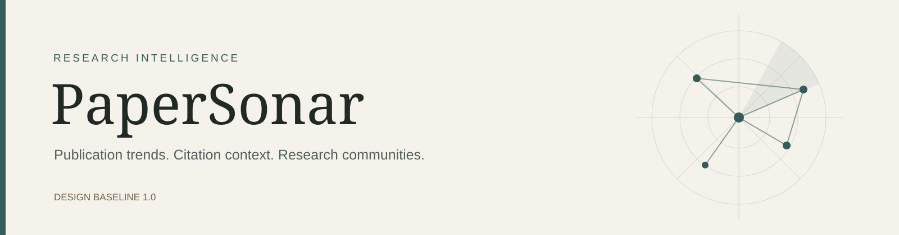
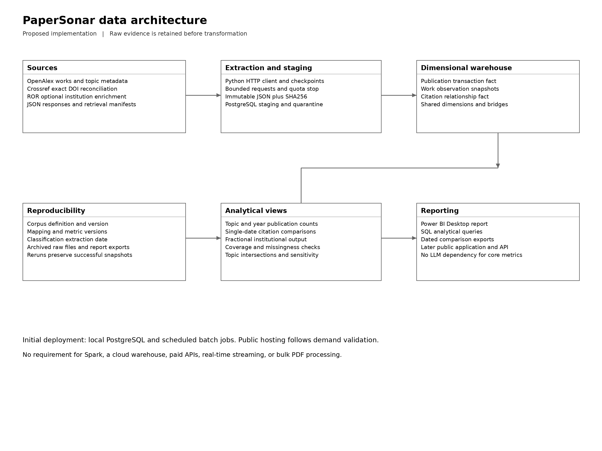
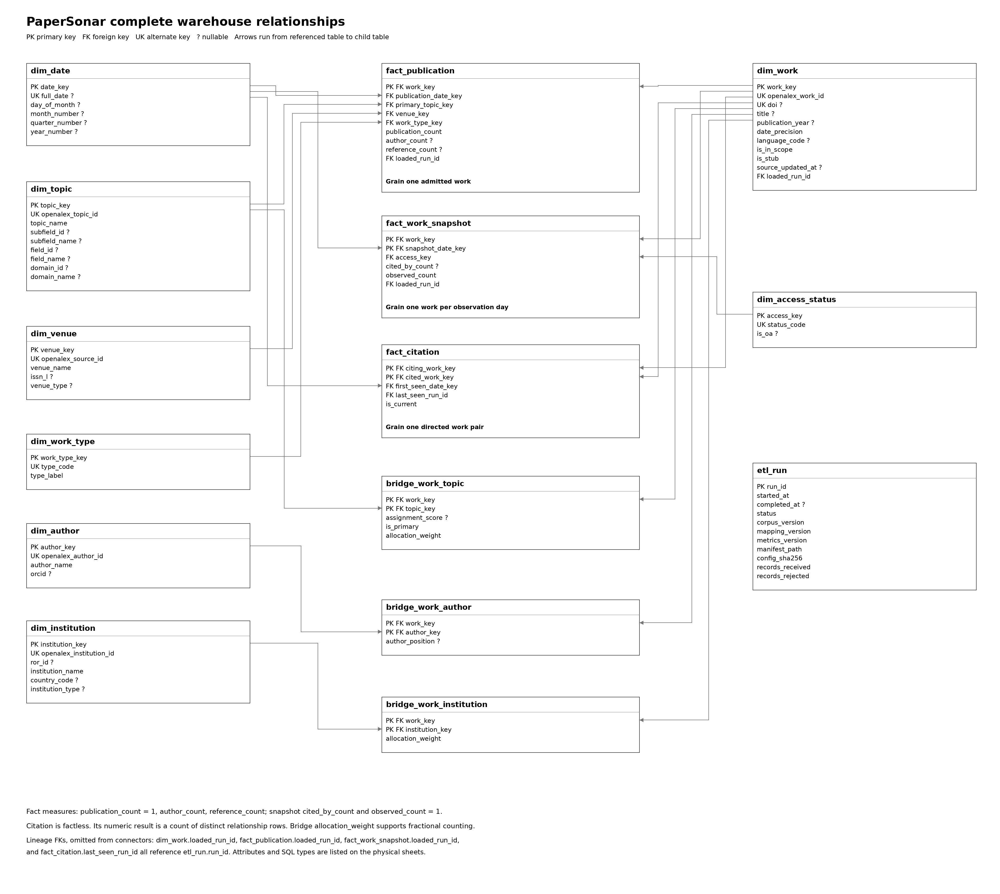

<p align="center">
  
</p>

<p align="center">
  <a href="docs/project-scope.md"></a>
  <a href="LICENSE"></a>
  <a href="docs/submissions/phase-1/README.md"></a>
</p>

<p align="center">
  <a href="#what-papersonar-is-for">Overview</a> ·
  <a href="docs/project-scope.md">Full scope</a> ·
  <a href="docs/architecture/README.md">Architecture</a> ·
  <a href="data/samples/README.md">Sample data</a> ·
  <a href="#roadmap">Roadmap</a>
</p>

# PaperSonar

PaperSonar is a research intelligence platform in development. It will help researchers compare research directions using publication activity, citation context, research communities, and the papers behind those measures.

The first release focuses on a bounded software engineering corpus. Its foundation is a dimensional warehouse with explicit counting rules, dated observations, and reproducible evidence. A later web application will let users save comparisons and export research dossiers.

**Current state:** the scope, requirements, dimensional design, data dictionary, diagrams, proposed SQL schema, and a real source pilot are available. The ETL pipeline, Power BI dashboards, and public application are planned.

## What PaperSonar is for

A researcher comparing software testing, software reliability, and web application security should be able to examine:

- How publication activity and relative topic share change over time.
- How citation counts compare within the same publication year and work type.
- Which institutions, authors, and venues repeatedly contribute to a direction.
- Which topic intersections warrant a closer literature review.
- Whether a shortlist changes when the counting method changes.

Every comparison will show its corpus, cutoff, observation date, counting method, and supporting publication identifiers. Sparse publication counts are treated as leads for investigation, not verified scientific gaps.

## The workflow we are building

| Capability | Intended behavior |
| --- | --- |
| Direction comparison | Compare topic growth, cohort citation impact, access, and participation using visible denominators. |
| Evidence dossiers | Retain the publications, data versions, and method behind a dated comparison. |
| Method sensitivity | Compare primary-topic counts with fractional attribution before trusting a ranking. |
| Intersection exploration | Inspect co-assigned papers alongside parent-topic volumes and coverage limits. |
| Data transparency | Keep missing metadata, partial years, reference coverage, and source revisions visible. |

These are product hypotheses to validate with researchers. The initial deliverable is the analytical foundation.

## Architecture



Python batch extraction will retain raw evidence before PostgreSQL staging and dimensional loading. Approved SQL views will feed Power BI Desktop. The planned public application will reuse those analytical definitions.

| Process | Table | Row grain |
| --- | --- | --- |
| Publication output | `fact_publication` | One admitted canonical scholarly work. |
| Citation and access observation | `fact_work_snapshot` | One admitted work on one successful observation day. |
| Reference relationship | `fact_citation` | One distinct directed citing and cited work pair. |

The model contains **8 dimensions, 3 facts, 3 attribution bridges, and 1 operational run log**. Bridges keep multiple topics, authors, and institutions from inflating publication counts.

<details>
<summary><strong>View the complete warehouse relationships</strong></summary>



[Download the diagram PDF](docs/architecture/diagrams/06_Complete_relationships.pdf) · [Open the editable DBML](docs/architecture/papersonar.dbml) · [Read the physical schema](database/schema/001_initial_schema.sql)

</details>

## Planned stack

<p>
  
  
  
  
  
</p>

The core design requires no paid model API, GPU, cloud warehouse, or LLM. Public hosting will be selected after the local workflow and resource use have been tested.

## Data and initial coverage

| Source | Role | Initial use |
| --- | --- | --- |
| [OpenAlex](https://help.openalex.org/api/) | Primary scholarly metadata | Works, topics, authorships, institutions, primary venues, citation observations, and matched references. |
| [Crossref](https://www.crossref.org/documentation/retrieve-metadata/rest-api/) | Exact DOI reconciliation | Check identifier matches and bibliographic discrepancies. |
| [ROR](https://ror.readme.io/docs/data-dump) | Optional institution enrichment | Resolve known ROR identifiers without automatic name matching. |

The proposed baseline covers **2016 to 2025**, with **2026 reported separately as partial**. The target is **30,000 to 60,000 admitted works**, subject to profiling and a complete, declared corpus boundary. The source pilot contains **20 actual publication records** and does not establish corpus-wide trends.

Source access assumptions were checked on 25 October 2026. The free pipeline is designed around bounded refreshes and quota limits. It does not depend on paid change-tracking filters or assume unlimited API access. See the [source plan](docs/sources.md) and [sample provenance](data/samples/README.md).

## Explore the repository

| Start here | What it contains |
| --- | --- |
| [Project scope](docs/project-scope.md) | Product distinctions, dataset boundaries, acquisition, analytics, delivery stages, and future scope. |
| [Phase 1 documents](docs/submissions/phase-1/README.md) | Five required reports in editable Word and PDF formats, plus the Excel data dictionary. |
| [Architecture](docs/architecture/README.md) | Conceptual, dimensional, and physical diagrams, model explanation, and editable DBML. |
| [Database design](database/README.md) | Proposed PostgreSQL schema and implementation boundaries. |
| [Sample data](data/samples/README.md) | Real source responses, a CSV sample, timestamps, and checksums. |
| [Design decisions](docs/decisions/001-initial-warehouse-design.md) | Initial modeling and refresh choices. |
| [Corpus configuration example](config/README.md) | Draft boundaries to finalize after profiling. |

```text
.
├── README.md
├── .gitignore
├── .env.example
├── config/
│   ├── README.md
│   └── corpus.example.json
├── database/
│   ├── README.md
│   └── schema/
├── data/
│   └── samples/
└── docs/
    ├── README.md
    ├── project-scope.md
    ├── sources.md
    ├── 00_PaperSonar_Project_scope.docx
    ├── assets/
    ├── decisions/
    ├── architecture/
    └── submissions/
        └── phase-1/
```

## Roadmap

- [x] Define the product scope and initial analytical questions.
- [x] Specify business requirements and acceptance conditions.
- [x] Design the facts, dimensions, bridges, keys, and grains.
- [x] Prepare the data dictionary and source pilot.
- [ ] Profile candidate topics and freeze the initial corpus.
- [ ] Implement restartable extraction, staging, and dimensional loading.
- [ ] Validate reconciliations and collect real observation snapshots.
- [ ] Implement the fourteen analytical queries and five Power BI report pages.
- [ ] Package a reproducible local analytical release.
- [ ] Validate saved comparison dossiers with researchers.
- [ ] Build the public interface and private saved comparisons.

## Working with the data

Only small documented samples belong in Git. Full raw responses, intermediate data, database dumps, credentials, logs, and generated outputs stay outside version control. Environment variable names are listed in [`.env.example`](.env.example); no runtime loader is implemented yet.

Citation history begins when observations are collected. Historical classifications require retained source versions. A current citation total cannot reconstruct a past observation, and a topic co-assignment cannot prove a research gap.

## License

Project code is covered by the repository's existing [MIT license](LICENSE). Third-party data has its own reuse terms, documented in the [sample data notes](data/samples/README.md). Linked article content is outside the metadata licence.
