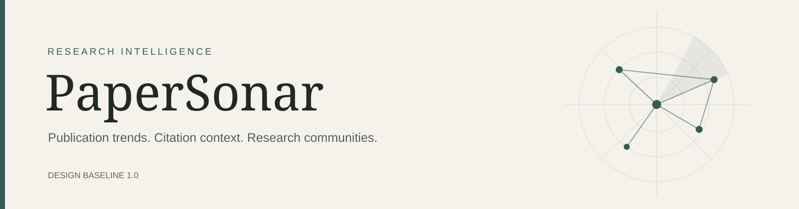

# PaperSonar

**Research & Innovation Intelligence Warehouse**

PaperSonar is a design-stage research intelligence platform that connects scholarly publications, preprints, datasets, research software, authors/creators, institutions, citations and related-output relationships. It is designed to help users compare research directions using transparent counts, dated observations, source provenance and supporting evidence.

> **Project state:** Phase 2 strict-ELT implementation is complete at repository level against the Nov 18 specification pack. Python extracts and uploads raw gzip NDJSON only; Snowflake performs staging, bronze, silver identity resolution, categorization, dimensional loads, DQ gating and publication. **Live acceptance is PARTIAL:** the OpenAlex full backfill (2026-11-17..18) reached `PUBLISHED` with 168,725 records; see [live evidence](docs/phase2/evidence/2026-11-19-openalex-full-load.md). OpenAlex incremental remains blocked by the Member+/Partner daily-sync plan. Phase 3 analytics/BI has not started. See the [implementation status](docs/phase2/IMPLEMENTATION_STATUS.md).

## The problem PaperSonar addresses

Researchers can find individual papers and datasets, but comparing possible research directions consistently is harder. PaperSonar proposes a reproducible warehouse that compares publication and artifact activity, citation context, topic intersections, creator/institution participation, open-access status, and links between papers, datasets and software. A sparse intersection is a review signal, never proof of novelty.

## Broader product scope

The target is a source-neutral research-output graph and dimensional analytics mart. It can represent:

- Journal and conference publications indexed in scholarly metadata services.
- Preprints and version histories.
- Research datasets and research software with persistent identifiers.
- Research reports and related scholarly outputs.
- Authors/creators, institutions, venues/repositories, topics, funders, access status and typed output relationships.
- Citations and related-output links where a source supplies them.

The first bounded corpus remains software engineering and adjacent computing topics. Broader resource types add scale and context without silently claiming coverage of all science. Corpus boundaries must be measured and versioned.

## Five-source plan

| Priority | Source | Main value | Incremental design |
|---:|---|---|---|
| 1 | [OpenAlex](https://api.openalex.org/) | Scholarly graph: works, authors, institutions, topics, sources and citation metadata | One-time full backfill; incremental uses `from_updated_date` (Member+/Partner daily sync required; no publication-date fallback) |
| 2 | [Crossref](https://api.crossref.org/) | DOI bibliographic metadata and reindex changes | Fixed `from-index-date` / `until-index-date` windows with cursor paging and overlap |
| 3 | [arXiv](https://export.arxiv.org/api/query) | Computing preprints, categories, abstracts and versions | OAI-PMH datestamp windows; preserve version observations |
| 4 | [DataCite](https://api.datacite.org/) | Datasets, software and other registered research outputs | Public API updated-date query or OAI-PMH; validate update semantics |
| 5 | [Zenodo](https://zenodo.org/api/) | Datasets, software, reports, versions and related identifiers | OAI-PMH datestamp windows, with API detail/backfill |

Do not add more sources until these five connectors have been individually tested. See [source strategy](docs/sources.md) for identities, API limitations, update windows, provenance, overlap and recovery rules.

## Target architecture

[PNG](docs/architecture/diagrams/07_Target_architecture_v2.png) · [PDF](docs/architecture/diagrams/07_Target_architecture_v2.pdf) · [SVG](docs/architecture/diagrams/07_Target_architecture_v2.svg) · [Architecture notes and logical model](docs/architecture/README.md)

Core layers: five public sources → deterministic extraction/upload → raw gzip NDJSON in the internal stage and batch manifest → Snowflake `PROJECT_STAGING` COPY → current-state `PROJECT_BRONZE` observations (one row per source record id) → `PROJECT_SILVER` typed observations, quarantine and identity crosswalk → `PROJECT_DW` conformed dimensions, facts and bridges → `PROJECT_REPORTING` publication-filtered secure views. `PROJECT_AUDIT` holds lifecycle, DQ, lineage and watermark evidence; `PROJECT_REF` holds versioned taxonomy, expected-key and rule contracts.

## Incremental loading and publication are implemented in SQL

A deterministic batch ID fixes each source window. Python writes one or more gzip NDJSON shards, uploads them, verifies staged size, registers the manifest, marks the batch `LOADED`, and triggers the Snowflake task graph. The lifecycle is `EXTRACTING → LOADED → PROCESSING → PUBLISHED / FAILED`.

All transformations, deduplication, identity resolution, category scoring, surrogate-key assignment and quality gating run in Snowflake SQL. Bronze preserves every raw observation version. Watermarks advance only after a batch passes the DQ gate and is published. Missing records are never treated as deletions. See [staging/bronze](docs/phase2/spec/06_STAGING_BRONZE.md), [silver](docs/phase2/spec/07_SILVER.md), and [DQ/reconciliation](docs/phase2/spec/11_DATA_QUALITY_RECONCILIATION.md).

## Platform strategy and Snowflake (Phase 2 decision)

Phase 2 has one production target: **Snowflake**, accessed with key-pair
authentication through the official Python connector. There is no PostgreSQL,
SQLite, or local-database fallback for ingestion; deterministic tests use a
mocked Snowflake adapter purely as a testing technique. Production runs must
use a currently available **no-cost** Snowflake trial/credits offer — Snowflake
is not guaranteed to be permanently free, paid resources are never activated,
and if no no-cost offer is available, live deployment stops and is reported as
**BLOCKED** (never switched to another database). Setup and operating
instructions: [Phase 2 runbook](docs/phase2/RUNBOOK.md). Historical Phase 1
free-first analysis: [platform decision](docs/decisions/002-free-first-warehouse-and-snowflake.md).

## Current dataset and scale

- Existing source pilot: 20 actual OpenAlex publication records plus a topic response, one Crossref DOI response, CSV sample and retrieval manifest.
- Initial historical baseline proposal: 2016–2025; 2026 is a partial period and must use common-cutoff comparisons.
- Candidate OpenAlex topics: `T10743`, `T12423`, `T12479`. These are not yet finalized.
- Proposed target: 30,000–60,000 canonical research outputs, subject to source profiling, inclusion rules, free API limits and measured storage. This is a target, not a confirmed count or arbitrary truncation cap.
- The five sources overlap. Do not add raw source result counts together and call them unique outputs.

## Warehouse model direction

The Phase 2 mart implements canonical research outputs, source observations,
identity crosswalks, citation snapshots, author/institution/topic/category
bridges, and typed output relations. `DIM_AUTHOR` is SCD2; all other dimensions
are Type 1 with stable surrogate keys from `DIMENSION_KEY_MAP`. Reporting views
expose only batches recorded in `PUBLISHED_BATCH`. The broader logical target is
documented in [architecture notes](docs/architecture/README.md) and the
[data dictionary v2](docs/submissions/phase-1/v2/data-dictionary-v2.xlsx); the
Phase 2 physical surrogate-key addendum is
[here](docs/phase2/PHASE2_DATA_DICTIONARY_ADDENDUM.md).

## Phase 2 implementation status

The repository contains the complete strict-ELT implementation for the Nov 18
phase 2 spec: five extractors, deterministic shard manifests, seven Snowflake
schemas, current-state bronze upserts, silver identity resolution, taxonomy
scoring, conformed dimensions, facts/bridges, a 12-rule DQ gate, a fail-closed
publish procedure, task-graph orchestration, and GitHub Actions for extraction
and SQL deployment. Static contracts and mocked tests pass.

The OpenAlex full backfill is live-proven end to end: 5 files, 168,725 records,
all CRITICAL DQ rules passing, and batch `BATCH_07D9668D4CBED88D815D30CA`
`PUBLISHED`. See [live evidence](docs/phase2/evidence/2026-11-19-openalex-full-load.md).
OpenAlex incremental, other sources, and the live zero-record path remain
**not live-proven**; OpenAlex incremental currently returns HTTP 403 because
`from_updated_date` requires a Member+/Partner plan. See the
[implementation status](docs/phase2/IMPLEMENTATION_STATUS.md),
[legacy acceptance report](docs/phase2/ACCEPTANCE_REPORT.md), and
[read-only acceptance queries](sql/99_tests/01_acceptance.sql).

## Course alignment

- **Phase 1 (30%):** proposal, business requirements, 10+ analytical questions, business processes, fact types and grains, dimensions/hierarchies, natural/surrogate keys, conceptual/logical/physical model, diagram and data dictionary.
- **Phase 2 (40%, implementation complete; live acceptance partial):** source ingestion, `project_staging`, `project_dw`, `project_reporting`, cleaning/transformation, surrogate-key loads, 168,725 OpenAlex outputs and citation snapshots in the live full load, and quality reports.
- **Phase 3 (30%, not started):** analytical SQL, `ROLLUP`, `CUBE`, reporting views, before/after `EXPLAIN ANALYZE`, indexes, three-page Power BI dashboard equivalent, screenshots, business insight report and final presentation.

The lab's retail sales examples are not copied into PaperSonar. Implement the same DWBI techniques using research-output measures. Full traceability is in [course requirements matrix](docs/requirements/course-requirements-matrix.md).

## Repository map

- `docs/project-scope.md` — product scope and boundaries (older baseline; use v2 docs for the expanded source design).
- `docs/sources.md` — five-source acquisition and incremental plan.
- `docs/architecture/README.md` — target architecture, logical entities and Snowflake compatibility.
- `docs/requirements/` — incremental design and course traceability.
- `docs/decisions/` — recorded architecture choices.
- `docs/submissions/phase-1/` — original Phase 1 artifacts retained for history.
- `docs/submissions/phase-1/v2/` — expanded Phase 1 design baseline and revised data dictionary.
- `docs/phase2/spec/` — the 20-document Nov 18 Phase 2 implementation pack plus the agent contract.
- `docs/phase2/IMPLEMENTATION_STATUS.md` — what is implemented, which live checks passed, and what remains BLOCKED/`VERIFY:`.
- `docs/phase2/REPOSITORY_AUDIT.md` — Phase 2 Step 0 audit artifact.
- `docs/phase2/SOURCE_CAPABILITY_MATRIX.md` — verified API facts and per-source implementation decisions.
- `docs/phase2/RUNBOOK.md` — operator runbook: Snowflake setup, secrets, commands, recovery, troubleshooting.
- `docs/phase2/ACCEPTANCE_REPORT.md` — legacy Phase 1/earlier Phase 2 requirement-to-evidence matrix (PASS / PASS-MOCK / BLOCKED).
- `docs/phase2/PHASE2_DATA_DICTIONARY_ADDENDUM.md` — physical Phase 2 surrogate-key columns.
- `docs/phase2/PHASE2_EVIDENCE_QUERIES.sql` — earlier read-only evidence queries; use `sql/99_tests/01_acceptance.sql` for the new model.
- `src/extract/` — five source adapters and raw gzip NDJSON writer.
- `src/runner/` — deterministic windows, Snowflake upload/manifest, CLI, SQL deployment.
- `src/papersonar/` — legacy Phase 1/earlier Phase 2 package retained until the force-push backup is complete; not used by the new workflow.
- `sql/00_setup/` … `sql/09_tasks/` — deployable strict-ELT SQL in layer order.
- `sql/99_tests/01_acceptance.sql` — read-only acceptance evidence queries.
- `tests/sql/test_sql_contracts.py` — static config/SQL drift and architecture guards.
- `.github/workflows/extract-load.yml` — scheduled/manual extraction, upload and graph trigger.
- `.github/workflows/deploy-ci.yml` — reviewed SQL deployment through the internal stage.
- `.github/workflows/legacy-phase2.yml.disabled` — old pipeline workflow, intentionally disabled.
- `config/corpus.example.json` — non-runnable source/corpus design contract.
- `database/schema/001_initial_schema.sql` — original publication-centered proposed schema; not the Phase 2 implementation.
- `data/samples/` — small pilot only; not a complete research corpus.

## Roadmap

1. [x] Initial PaperSonar scope, publication-centered model and 20-record pilot.
2. [x] Expand Phase 1 source strategy and target architecture to five sources.
3. [ ] Profile topic/year/resource-type partitions and source overlap.
4. [ ] Approve source-neutral logical model and revised physical dictionary.
5. [ ] Freeze corpus boundary, storage budget, refresh cadence and free-service assumptions.
6. [~] Phase 2: strict-ELT extractors, current-state bronze, silver identity, dimensional model, DQ gate, publication views and task graph — **repository implementation complete; OpenAlex full load live-proven, incremental blocked by Member+/Partner plan**.
7. [ ] Phase 3: implement analytical SQL, OLAP, reporting views, optimization report and Power BI deliverables.
8. [ ] Validate evidence dossiers and direction-comparison workflow with researchers.

## Licensing and evidence

The repository code licence does not automatically license external metadata or linked full-text content. Retain source, licence/terms reference, extraction time, source identifier, raw checksum and transformation version. Full raw records, credentials, logs, and database dumps stay out of Git. API limits and source policies must be rechecked before implementation.
