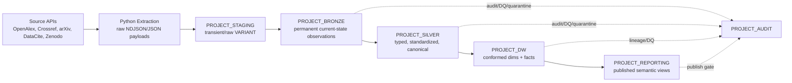

# PaperSonar Data Warehouse Evaluation Prep

## Purpose

This document is a focused preparation guide for a **data warehouse / data engineering evaluation** of PaperSonar Phase 2. It explains how the project handles **data ingestion, schema/layer design, Bronze, Silver, watermarks, MERGE INTO, SCDs, audit/DQ, and publication control**, and it includes **targeted senior-teacher questions** with what a strong answer should cover.

This guide is grounded in the repository implementation and Phase 2 specs, especially:

- `docs/agents/Phase2/01_ARCHITECTURE_AND_NAMING.md`
- `docs/agents/Phase2/03_SOURCES_AND_EXTRACTION.md`
- `docs/agents/Phase2/06_STAGING_BRONZE.md`
- `docs/agents/Phase2/07_SILVER.md`
- `docs/agents/Phase2/09_DIMENSIONAL_MODEL_DW.md`
- `docs/agents/Phase2/13_AUDIT_METADATA_LINEAGE.md`
- `sql/00_setup/04_audit_ddl.sql`
- `sql/01_staging/*`, `sql/02_bronze/02_merge_batch.sql`
- `sql/03_silver/02_transform_batch.sql`
- `sql/05_dimensions/04_load_dimensions.sql`
- `sql/07_reporting/03_publish_batch.sql`
- `sql/08_audit_dq/*`

---

## 1. High-Level Architecture

PaperSonar follows a **strict ELT** design:

- **Python extracts and uploads raw records** to stage/storage.
- **Snowflake SQL transforms** data through Staging, Bronze, Silver, DW, and Reporting.
- Python does **not** perform business cleaning, categorization, deduplication, or surrogate-key assignment.

### Layer flow



### Schema responsibility

| Schema | Purpose | Key property |
|---|---|---|
| `PROJECT_STAGING` | Raw load boundary | Transient/load-oriented; raw `VARIANT` payload + file/batch metadata |
| `PROJECT_BRONZE` | Raw current-state observations | Permanent; source payload preserved; idempotent MERGE by source record identity |
| `PROJECT_SILVER` | Cleaned/typed/canonical layer | Standardization, validation, identity resolution, survivorship, quarantine |
| `PROJECT_DW` | Dimensional warehouse | Conformed dimensions, SCD2 author, facts, bridge tables |
| `PROJECT_REPORTING` | Consumer-facing views | Only published batches exposed |
| `PROJECT_AUDIT` | Operational control/audit | Batch, manifest, watermark, DQ, quarantine, lineage, run logs |
| `PROJECT_REF` | Reference/control data | Taxonomy, expected keys, DQ rules, mappings |

---

## 2. Data Ingestion Design

### 2.1 Extraction contract

- Sources: **OpenAlex, Crossref, arXiv, DataCite, Zenodo**.
- Extraction is responsible for fetching source records, preserving raw payloads, registering files/manifests, and tracking batch/window metadata.
- Raw records are written as files (NDJSON/JSON pattern) and loaded through Snowflake `COPY INTO`.
- Extraction must not "fix" business data; it preserves what the source returned.

### 2.2 Staging contract

Staging is the **raw landing boundary** in Snowflake.

Typical staging columns:

| Column | Type | Why |
|---|---|---|
| `PAYLOAD` | `VARIANT` | Preserves raw JSON/XML-derived structure |
| `FILE_NAME` | `VARCHAR` | File lineage |
| `FILE_ROW_NUMBER` | `NUMBER` | Deterministic row ordering/dedupe tie-breaker |
| `BATCH_ID` | `VARCHAR` | Batch lineage |
| `LOADED_AT` | `TIMESTAMP_NTZ` | Load timestamp |

Design choices:

- **Explicit DDL and explicit file formats**; no `INFER_SCHEMA`.
- `COPY INTO` options are deliberate; malformed/oversized behavior must be visible.
- Staging is not the long-term business truth; it is a controlled input to Bronze.

### 2.3 Batch and manifest control

Audit tables in `PROJECT_AUDIT` provide ingestion control:

- `BATCH` - logical extraction window and lifecycle state.
- `BATCH_MANIFEST` - one row per source/entity/file extraction unit; checksum, size, record count, window, cursor, status.
- `FILE_LOAD_LOG` - COPY reconciliation per file.
- `CURRENT_BATCH` - active batch control table for task graph.
- `PUBLISHED_BATCH` - only batches exposed through reporting.

This gives traceability from **file -> staging -> bronze -> silver -> DW -> reporting**.

---

## 3. Bronze Layer: Raw, Permanent, Current-State

Bronze is **permanent** and stores source observations with minimal technical shaping but no business transformation.

### 3.1 Bronze table contract

Required metadata includes:

- `SOURCE_NAME`, `ENTITY_NAME`, `SOURCE_RECORD_ID`
- `BATCH_ID`, `WINDOW_START`, `WINDOW_END`
- `RECORD_HASH`, `CHECKSUM`
- `FILE_NAME`, `PAYLOAD`, `INGESTED_AT`

The raw `PAYLOAD` remains unchanged. Bronze is the durable raw record store used for replay, audit, and downstream transformation.

### 3.2 Why Bronze is current-state, not append-only

PaperSonar Bronze keeps **one current row per `(SOURCE_NAME, ENTITY_NAME, SOURCE_RECORD_ID)`**. If the same source record is fetched again, the row is **updated in place**.

Reasoning:

- Avoids duplicate logical observations for re-fetched records.
- Preserves a stable current-state raw observation for deterministic downstream processing.
- Still keeps batch/window/hash/checksum metadata for lineage.
- DQ-002 reconciles bronze observations to distinct staged record keys, not record hashes, so changed content is still one observation.

### 3.3 MERGE INTO pattern in Bronze

`sql/02_bronze/02_merge_batch.sql` uses a deduplicated source before MERGE:

1. Read staged rows for the active `BATCH_ID`.
2. Extract `SOURCE_RECORD_ID` from payload.
3. Join batch/window metadata and manifest checksum.
4. Filter missing required IDs.
5. `QUALIFY ROW_NUMBER() OVER (PARTITION BY source_record_id ORDER BY FILE_NAME DESC, FILE_ROW_NUMBER DESC) = 1`.
6. `MERGE INTO ... WHEN MATCHED UPDATE ... WHEN NOT MATCHED INSERT ...`.
7. Missing required IDs go to `QUARANTINE_RECORD` with reason `MISSING_REQUIRED_ID`.

Example pattern:

```sql
MERGE INTO PROJECT_BRONZE.BRZ_OPENALEX_WORK t
USING (
  SELECT ...
  FROM PROJECT_STAGING.STG_OPENALEX_WORK s
  ...
  WHERE s.BATCH_ID = :batch_id
    AND COALESCE(s.PAYLOAD:id::STRING, '') <> ''
  QUALIFY ROW_NUMBER() OVER (
    PARTITION BY REGEXP_REPLACE(s.PAYLOAD:id::STRING, '^https?://openalex[.]org/', '')
    ORDER BY s.FILE_NAME DESC, s.FILE_ROW_NUMBER DESC
  ) = 1
) s
ON t.SOURCE_NAME = s.SOURCE_NAME
AND t.ENTITY_NAME = s.ENTITY_NAME
AND t.SOURCE_RECORD_ID = s.SOURCE_RECORD_ID
WHEN MATCHED THEN UPDATE ...
WHEN NOT MATCHED THEN INSERT ...
```

### 3.4 Why QUALIFY / dedupe before MERGE matters

Snowflake `MERGE` requires that a target row is not affected by multiple source rows in ambiguous ways. Even where behavior varies, the safe warehouse pattern is:

- **Deduplicate the MERGE source to exactly one row per target key**.
- Use deterministic ordering so reruns produce the same winner.
- Make idempotency explicit, not accidental.

### 3.5 Bronze idempotency and replay

- Re-running the same batch should not create duplicate bronze observations.
- `RECORD_HASH` is computed as `SHA2(TO_JSON(PAYLOAD), 256)` for the staged payload; the code comments note determinism assumptions.
- `COPY` load history is useful but not treated as the long-term idempotency guarantee.
- Quarantine is used for missing required IDs; records are not silently dropped.

---

## 4. Silver Layer: Typed, Cleaned, Canonical, Auditable

Silver converts raw bronze observations into **typed, standardized, deduplicated canonical records**.

### 4.1 Silver responsibilities

Implemented in `sql/03_silver/02_transform_batch.sql`:

- Read active batch from `CURRENT_BATCH`.
- Delete/rebuild batch-scoped silver observation and crosswalk rows for that batch.
- Project source-specific payloads into a common typed structure (`SLV_SOURCE_OBSERVATION`).
- Normalize/validate fields using SQL UDFs (`FN_NORMALIZE_DOI`, `FN_IS_VALID_DOI`, `FN_NORMALIZE_TITLE`, `FN_OUTPUT_BK`, `FN_SOURCE_PRIORITY`).
- Quarantine classified defects (`INVALID_DOI`, `INVALID_DATE`, `UNSUPPORTED_SHAPE`) while preserving traceability.
- Build deterministic identity crosswalk (`SLV_OUTPUT_CROSSWALK`).
- Upsert canonical output (`SLV_RESEARCH_OUTPUT`) using survivorship/source priority.
- Log schema drift against `REF_EXPECTED_KEY`.
- Write lineage/audit events.

### 4.2 Standardization examples

| Concern | Handling |
|---|---|
| DOI | Normalize DOI; validate format; invalid DOI is quarantined/classified, not silently "fixed" |
| Dates | `TRY_TO_DATE` / `TRY_TO_TIMESTAMP_NTZ`; invalid/unparseable dates become classified issues |
| Numeric/casts | Safe conversion patterns; bad values are visible |
| Titles | Preserve display/title raw where needed; normalized title used for matching |
| Nested arrays | `LATERAL FLATTEN`/source-specific extraction patterns in SQL |
| Required nulls | Explicit null rules; required missing values can be rejected/quarantined |

### 4.3 Identity resolution and crosswalk

Silver does not blindly merge by title. It uses deterministic identity precedence, represented in code/comments/spec as:

1. Valid normalized DOI.
2. arXiv ID where appropriate.
3. Normalized title + publication year + first-author hash.
4. Fuzzy matching only as controlled residual path (not silent auto-merge).

`SLV_OUTPUT_CROSSWALK` maps `(SOURCE_NAME, ENTITY_NAME, SOURCE_RECORD_ID, RECORD_HASH)` to `OUTPUT_BK` with:

- `MATCH_METHOD` - e.g., DOI / ARXIV / TITLE_AUTHOR_YEAR
- `CONFIDENCE`
- `RULE_VERSION`
- `BATCH_ID`

This makes identity decisions auditable and reproducible.

### 4.4 Survivorship

Canonical output in `SLV_RESEARCH_OUTPUT` is built with source precedence. The SQL uses `FN_SOURCE_PRIORITY` and deterministic ordering:

```sql
ROW_NUMBER() OVER (
  PARTITION BY c.OUTPUT_BK
  ORDER BY
    PAPERSONAR.PROJECT_SILVER.FN_SOURCE_PRIORITY(o.SOURCE_NAME),
    o.INGESTED_AT DESC,
    o.SOURCE_RECORD_ID
) AS rn
```

This means the "winner" for canonical attributes is rule-based and explainable. Citation counts are treated carefully: source-specific observations should not be naively summed across sources.

### 4.5 Silver idempotency

- Batch-scoped observation/crosswalk rows are deleted and reinserted for the active batch.
- Canonical output is `MERGE`d by `OUTPUT_BK`.
- Quarantine inserts are guarded against duplicates.
- Schema drift and lineage events use deterministic IDs / MERGE patterns.

This allows safe reruns without double-counting batch-scoped silver rows.

---

## 5. Watermarks, Batch Windows, and Publication Gate

Watermarks are critical for incremental ingestion. PaperSonar treats them as **committed checkpoints**, not "last attempted time".

### 5.1 Watermark table

`PROJECT_AUDIT.SOURCE_WATERMARK` stores, per source/entity:

- `WATERMARK_VALUE`
- `WINDOW_START`, `WINDOW_END`
- `OVERLAP_DAYS`
- `CURSOR`
- `LAST_BATCH_ID`
- `LAST_SUCCESS_AT`
- `STATUS`
- `UPDATED_AT`

### 5.2 Watermark rule

A watermark advances only after the data for that checkpoint is durably committed/published according to the pipeline rules. The publish procedure is the gate.

`SP_PUBLISH_BATCH` in `sql/07_reporting/03_publish_batch.sql` enforces:

- No batch -> `NO_BATCH`
- No DQ results -> `BLOCKED_NO_DQ`
- Incomplete DQ run -> `BLOCKED_INCOMPLETE_DQ`
- Any CRITICAL DQ failure -> `BLOCKED_DQ`
- Otherwise publish batch and update watermark appropriately.

### 5.3 Capped vs complete windows

This is an important design detail:

| Case | Published? | Watermark advanced as complete? | Why |
|---|---:|---:|---|
| Complete window, DQ passed | Yes | Yes | Window fully processed |
| Capped window (`IS_CAPPED=TRUE`), DQ passed | Yes, for visibility | No complete-window advance; stores resume cursor/start | Part of window was not read |
| DQ missing/incomplete/critical fail | No | No | Fail closed |

For capped windows, the code publishes with `PUBLISHED_CAPPED` status behavior but stores cursor/window start so the next run resumes the same logical window.

### 5.4 Full backfill vs incremental watermark

The publish SQL includes a deliberate safeguard:

- Incremental windows are updated-date windows: `WINDOW_END` can be used as watermark.
- Full backfill windows may be publication-date windows; advancing an updated-date watermark to that old window end would be wrong.
- Therefore full backfill uses `CURRENT_DATE()` as watermark value, while still using `GREATEST` to avoid moving backward.

This shows awareness of **watermark semantic meaning**, not just storing dates.

---

## 6. Schema Design and Modeling Choices

### 6.1 Schema/layer separation

The schema split is a data-governance decision:

- Staging = load boundary
- Bronze = raw durable observation
- Silver = cleaned/canonical
- DW = dimensional model
- Reporting = consumer contract
- Audit/Ref = control plane

This prevents raw, intermediate, and consumer layers from being mixed.

### 6.2 Naming and grain

The project uses explicit naming conventions and grains:

- Surrogate keys: `<ENTITY>_SK` / `<ENTITY>_KEY` style as defined by model.
- Business keys: source/canonical identifiers.
- Batch lineage: `BATCH_ID`.
- Hash: `RECORD_HASH`, `HASH_DIFF`.
- SCD2 current row: `IS_CURRENT`, `EFFECTIVE_FROM`, `EFFECTIVE_TO`, `VERSION`.

Each table/procedure should have clear grain and idempotency. Audit tables declare constraints as metadata where Snowflake does not enforce them; correctness is enforced by load logic and DQ checks.

### 6.3 Dimensional model

DW uses conformed dimensions and facts. The prep重点 is SCD handling:

- **SCD Type 1**: overwrite-in-place for attributes where history is not required (many conformed dims).
- **SCD Type 2**: `DIM_AUTHOR` tracks historical changes with hash diff and effective dating.
- Facts join to appropriate dimension keys; SCD2 joins should be point-in-time correct when needed.

---

## 7. SCD Handling (Focus: DIM_AUTHOR)

`DIM_AUTHOR` is implemented as **SCD Type 2** in `sql/05_dimensions/02_dim_author_institution.sql` and loaded by `sql/05_dimensions/04_load_dimensions.sql`.

### 7.1 Why SCD2 for author

Author attributes such as name representation or ORCID/affiliation-related identity signals can change over time. If history matters for analytics or auditability, Type 1 overwrite would lose previous state.

### 7.2 SCD2 columns

`DIM_AUTHOR` includes:

- `AUTHOR_SK` - surrogate key, sequence-generated
- `AUTHOR_KEY` - business key
- `AUTHOR_NAME`, `ORCID` - tracked attributes
- `HASH_DIFF` - hash of tracked attributes for change detection
- `EFFECTIVE_FROM`, `EFFECTIVE_TO`
- `IS_CURRENT`
- `VERSION`

### 7.3 SCD2 load pattern

The load process:

1. Build batch author candidates in staging helper table (`STG_DIM_AUTHOR`).
2. Compute `HASH_DIFF` from tracked attributes.
3. `MERGE` into `DIM_AUTHOR` on `AUTHOR_KEY AND IS_CURRENT`.
4. If matched and hash changed, expire current row:
   - `EFFECTIVE_TO = CURRENT_TIMESTAMP()`
   - `IS_CURRENT = FALSE`
5. Insert new version for new/changed keys:
   - new `AUTHOR_SK` from sequence
   - `EFFECTIVE_FROM = CURRENT_TIMESTAMP()`
   - `EFFECTIVE_TO = NULL`
   - `IS_CURRENT = TRUE`
   - `VERSION = COALESCE(MAX_VERSION,0)+1`

This is the standard two-step SCD2 pattern adapted to set-based SQL.

### 7.4 SCD2 invariants

A strong implementation should guarantee:

- At most/expected **one current row per business key**.
- New version only when tracked attributes changed.
- No accidental history rewrite.
- Facts can resolve current or historical author as required.
- Unknown member exists (`AUTHOR_SK=0`, `AUTHOR_KEY='-1'`) for defensive DW joins.

---

## 8. Audit, Quarantine, DQ, and Lineage

### 8.1 Quarantine, not silent drop

Invalid records are classified and recorded in `PROJECT_AUDIT.QUARANTINE_RECORD`. Examples:

- `MISSING_REQUIRED_ID`
- `INVALID_DOI`
- `INVALID_DATE`
- `UNSUPPORTED_SHAPE`
- schema drift required-key issues

This preserves evidence and supports reconciliation.

### 8.2 Data quality gate

DQ results live in `PROJECT_AUDIT.DQ_RESULT`. Publication is fail-closed:

- Missing DQ = blocked.
- Incomplete DQ = blocked.
- Critical DQ failure = blocked.

This prevents bad data from becoming "official" reporting data.

### 8.3 Lineage

`LINEAGE_EVENT` captures layer/object/event/input-output counts. Crosswalk tables provide source-record to canonical-output identity lineage. Bronze preserves raw payloads; audit stores references/metadata rather than duplicating full raw payloads unnecessarily.

### 8.4 Recovery/replay

The design expects safe replay. Manifest status alone is not proof of data correctness. Recovery compares actual table state, manifests, checksums, and audit records before advancing.

---

## 9. How to Explain "How We Handled It" in an Evaluation

When answering, use this structure:

1. **What the problem was** - e.g., duplicate source records, late-arriving updates, invalid dates, schema drift.
2. **Where it was handled** - staging/bronze/silver/DW/audit.
3. **How it was handled** - specific SQL pattern, table, rule, or procedure.
4. **Why this choice** - correctness, idempotency, auditability, cost, replay safety.
5. **Tradeoff/limitation** - what is not perfect and how it is mitigated.

Example:

> "For Bronze ingestion, we used `MERGE INTO` on `(SOURCE_NAME, ENTITY_NAME, SOURCE_RECORD_ID)` after deduplicating staged rows with `QUALIFY ROW_NUMBER()`. This handles re-extracted files and changed payloads idempotently, keeps one current raw observation per source record, and avoids duplicate logical rows. The tradeoff is that Bronze is current-state, so historical raw changes are represented through batch/hash metadata and audit lineage rather than append-only raw version rows."

---

## 10. Targeted Senior-Teacher Questions

## A. Data Ingestion and Staging

1. **Why did you choose ELT instead of ETL for this project?**
   - Strong answer: raw extraction in Python; transformation in Snowflake SQL for set-based processing, auditability, scalability, and proximity to data; Python avoids business transformation.

2. **What is the grain of your staging table and why do you keep `FILE_NAME` and `FILE_ROW_NUMBER`?**
   - Strong answer: row-level raw load boundary; supports deterministic dedupe ordering, lineage, replay, and debugging file-level issues.

3. **Why use `VARIANT` for staging payloads instead of inferring columns immediately?**
   - Strong answer: preserves raw source fidelity, handles semi-structured/nested payloads, allows explicit downstream projection, avoids `INFER_SCHEMA` instability.

4. **How do you prevent bad files or malformed rows from silently corrupting ingestion?**
   - Strong answer: explicit file format/COPY options, manifest/checksum, FILE_LOAD_LOG reconciliation, quarantine/audit, DQ checks, fail-closed publication.

5. **What is the difference between manifest status and actual data correctness?**
   - Strong answer: manifest is control metadata; data correctness requires reconciling counts/checksums/table state/DQ results.

## B. Bronze and MERGE INTO

6. **Why is Bronze permanent and current-state in your design?**
   - Strong answer: durable raw observation store; one row per source record identity; updates on re-fetch; supports replay/audit without duplicate logical observations.

7. **Walk me through your Bronze `MERGE INTO`. What is the target key?**
   - Strong answer: key is `(SOURCE_NAME, ENTITY_NAME, SOURCE_RECORD_ID)`; source is deduped staged batch; matched updates metadata/payload/hash; not matched inserts.

8. **Why do you use `QUALIFY ROW_NUMBER()` before MERGE?**
   - Strong answer: ensures one source row per target key; deterministic winner by file/row order; prevents ambiguous MERGE behavior and supports idempotency.

9. **What happens if the same source record arrives again with changed content?**
   - Strong answer: same business/source identity => matched update; `RECORD_HASH`/payload/batch metadata updated; DQ treats as same observation, not duplicate.

10. **How do you handle missing required IDs in Bronze?**
    - Strong answer: filter them out of merge source; insert deterministic quarantine record with `MISSING_REQUIRED_ID`; no silent drop.

11. **Is `RECORD_HASH` enough for deduplication? Why or why not?**
    - Strong answer: hash helps detect content change/integrity, but logical dedupe key is source record identity; hash alone cannot define entity identity and can change on benign/content updates.

12. **What are the risks of MERGE in Snowflake/data warehouses, and how did you mitigate them?**
    - Strong answer: duplicate source keys, nondeterministic updates, large scans, partial failure/replay; mitigated by batch scope, dedupe, deterministic ordering, audit, idempotent procedures.

## C. Watermarks and Incremental Loading

13. **What is a watermark, and what exactly does your watermark represent?**
    - Strong answer: committed progress marker per source/entity; includes value/window/cursor/status/last batch; represents safe resume point after durable publish.

14. **When does a watermark advance? When must it not advance?**
    - Strong answer: advances only after successful publish gate for eligible window; must not advance on failed extraction/load/transform/DQ, or as complete window when batch is capped.

15. **How did you handle capped/max-record windows?**
    - Strong answer: batch can be published for visibility as capped, but watermark stores resume cursor/window start and does not claim full window completion.

16. **Why is full-backfill watermark handling different from incremental watermark handling?**
    - Strong answer: incremental uses updated-date window end; full backfill may be publication-date based, so using old window end could move updated-date watermark backward; code uses `CURRENT_DATE()` with `GREATEST`.

17. **How do you ensure incremental loads are idempotent?**
    - Strong answer: stable batch IDs/manifests/checksums, deterministic MERGE keys, batch-scoped deletes/rebuilds where appropriate, replay-safe watermark advancement only after commit/publish.

18. **What happens if the pipeline fails after Bronze load but before watermark update?**
    - Strong answer: watermark not advanced; rerun/replay reconciles batch state; no data loss/duplicate logical observations due idempotent merges and audit state.

## D. Silver Layer

19. **What is the purpose of Silver, and how is it different from Bronze?**
    - Strong answer: Bronze preserves raw current-state observations; Silver applies typed projection, normalization, validation, identity resolution, survivorship, and canonicalization.

20. **How do you clean data without using Python transformations?**
    - Strong answer: SQL UDFs/functions, `TRY_*` casts, regex/XML/JSON extraction, controlled reference tables, set-based SQL procedures.

21. **How do you handle invalid DOI/date values?**
    - Strong answer: classify and quarantine with reason codes; do not silently coerce or drop; preserve raw value/provenance where safe.

22. **Explain your identity resolution/crosswalk design.**
    - Strong answer: deterministic precedence (DOI, arXiv, title+year+first author hash); crosswalk stores match method/confidence/rule version; avoids blind title merges.

23. **What is survivorship and why is it needed in multi-source ingestion?**
    - Strong answer: multiple sources may describe same canonical output; survivorship chooses attribute values by source priority/quality rules deterministically.

24. **Why delete and reinsert batch-scoped Silver observation/crosswalk rows?**
    - Strong answer: simplifies idempotent batch replay for batch-owned tables; canonical output still upserted by business key.

25. **How do you detect schema drift?**
    - Strong answer: compare payload keys against `REF_EXPECTED_KEY`; log missing required/new keys in `SCHEMA_DRIFT_LOG`; required-key loss can block/fail as per DQ policy.

## E. Schema, SCD, and DW Modeling

26. **Why separate schemas by layer instead of putting all tables in one schema?**
    - Strong answer: clear responsibility, access control, blast-radius reduction, lineage, deployment/manageability, consumer safety.

27. **What is SCD Type 2, and why did you use it for `DIM_AUTHOR`?**
    - Strong answer: tracks historical attribute changes via new version rows; author attributes may change and history can matter; implemented with hash diff/effective dates/current flag/version.

28. **How does your SCD2 merge detect changes?**
    - Strong answer: compute `HASH_DIFF` over tracked attributes; if current row exists and hash differs, expire it; insert new current version.

29. **What prevents multiple current SCD2 rows for the same author?**
    - Strong answer: load pattern targets `AUTHOR_KEY AND IS_CURRENT`, change detection, controlled insert, and DQ rule checks for one current row per business key.

30. **Why use a surrogate key sequence for SCD2?**
    - Strong answer: business key identifies entity; surrogate key identifies version/row for fact joins and historical integrity.

31. **When would you choose SCD1 over SCD2?**
    - Strong answer: when history is not required, attribute corrections should overwrite, and audit/history cost is unnecessary; PaperSonar uses Type 1 for many conformed dims.

32. **How do facts join to an SCD2 dimension correctly?**
    - Strong answer: for current-state use `IS_CURRENT=TRUE`; for historical accuracy use point-in-time join where fact/event date falls between `EFFECTIVE_FROM` and `EFFECTIVE_TO`.

## F. Audit, DQ, and Operations

33. **What makes your pipeline idempotent end-to-end?**
    - Strong answer: deterministic IDs/keys, manifest/checksums, deduped MERGE sources, batch-scoped rebuilds, quarantine dedupe, watermark advancement only after publish, fail-closed DQ.

34. **What does "fail closed" mean in your publication gate?**
    - Strong answer: if DQ evidence is missing/incomplete/critical-failing, data is not published; absence of failure is not treated as success.

35. **How do you prove no records were silently dropped?**
    - Strong answer: staging/bronze/silver/quarantine reconciliation, DQ counts, audit logs, manifests, reason-coded quarantine records.

36. **What would you improve if this moved to production scale?**
    - Strong answer: stronger canonical JSON hashing strategy, parallelized source loads, more granular observability/SLAs, cost/perf tuning, automated schema evolution policy, CDC/stream options where justified, stronger data contracts and CI data tests.

---

## 11. Rapid-Fire Viva Questions

- What is the grain of `BATCH_MANIFEST`?
- Why does Bronze store `PAYLOAD` even after Silver exists?
- What is the difference between `RECORD_HASH` and `HASH_DIFF`?
- Why can a capped batch be published but not advance the complete watermark?
- What is the target key of your Bronze MERGE?
- Why is `QUALIFY` important before `MERGE`?
- What happens when DQ has not run?
- How do you avoid duplicate SCD2 current rows?
- Why not use `INFER_SCHEMA`?
- Why is Python not allowed to clean/categorize data in Phase 2?
- How would you debug a missing record from source to reporting?
- What is the tradeoff of current-state Bronze vs append-only Bronze?

---

## 12. Suggested Whiteboard Exercise

Draw and explain this sequence:

1. Source API -> raw file -> staging `COPY INTO`.
2. Staging -> Bronze `MERGE` with `QUALIFY` dedupe.
3. Bronze -> Silver typed projection + quarantine + crosswalk + canonical MERGE.
4. Silver -> DW dims/facts; author as SCD2.
5. DQ gate -> publish batch -> watermark advance only if complete.
6. Reporting views expose only published batches.

Be ready to point to the exact SQL/procedure for each step. A strong evaluation answer names the **table, key, procedure, idempotency rule, and failure behavior**.
