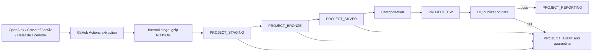

# PaperSonar — Phase 2 Implementation Specification

## Purpose and scope
PaperSonar is a research-intelligence warehouse comparing topics through publications, citations, datasets, and software. Its five source systems are OpenAlex, Crossref, arXiv, DataCite, and Zenodo. This specification is the implementation contract for DL3004 Phase 2. Preserve all Phase 1 artifacts under `docs/submissions/phase-1/` and related architecture, requirements, and data-dictionary documents. Existing Phase 2 code is considered disposable only after the required backup/tag steps in `16_REPO_STRUCTURE_FORCE_PUSH.md`.

## Binding decisions
- Strict ELT: Python extracts and uploads raw data; Snowflake SQL performs all transformations.
- Raw files are gzip NDJSON in an internal stage. No cleaning, deduplication, categorization, or surrogate-key assignment in Python.
- No schema inference. Use explicit DDL and log schema drift.
- Batch lifecycle: `EXTRACTING -> LOADED -> PROCESSING -> PUBLISHED`, with `FAILED` and safe retry paths.
- Watermarks advance only after durable bronze commit/checkpoint.
- Dimensions are never routinely truncated and reloaded. Surrogate keys remain stable.
- A critical DQ failure blocks publication.
- No Phase 3 analytics, dashboard, advanced aggregation, benchmark comparison, or business-insights report.
- Each SQL file documents purpose, inputs, outputs, idempotency, owner, parameters, and cost considerations.
- All unverified account/source behavior is marked `VERIFY:` and checked against official documentation.

## Rubric targets
| Requirement | Target |
|---|---:|
| Dimension records | >=100 |
| Fact records | >=10,000 |
| Orphan fact-to-dimension references | 0 |
| Critical DQ failures in published batch | 0 |
| Demonstrated full load | Yes; bronze is not truncated |
| Demonstrated incremental load | Yes |
| Stable surrogate keys after rerun | Yes |
| Reports | Data Cleaning Report and Data Quality Report |
| Live Snowflake evidence | Required |

## Architecture

## Throughput and cost
Initial target: process 10,000 valid research-output fact rows within 60 minutes of files being staged, excluding extraction and initial backfill. This is a target, not a guarantee. Record rows/minute, file sizes, query/task duration, query IDs, credits, accepted/rejected counts, and layer-to-layer reconciliation. Baseline before tuning. Credit impact must be recorded for each major design choice.

The project brief assumes a 30-day/$400-credit trial; verify actual account balance, expiry, edition, and feature access. Put a resource monitor and suspension policy in place before enabling warehouses. Cortex remains disabled by default.

## Definition of done
All required SQL, extraction, orchestration, data-quality, audit, dimensional, and reporting specifications are implemented; five sources are documented; live full and incremental runs are evidenced; dimensions and facts meet row targets; orphan count is zero; reruns are idempotent; reports are generated from actual data; Phase 1 files remain intact; repository push and evidence are documented.

## Phase 3 hand-off notes
Phase 2 leaves a stable star schema and basic semantic views for later analytics. Advanced analytical SQL, dashboarding, EXPLAIN/benchmark comparisons, business-insight reports, and presentations are out of scope.

## Open questions to resolve from repository/account
1. Which Phase 1 data dictionary is authoritative?
2. Which fields and keys are already defined there?
3. What edition, credit balance, expiry, and features are actually enabled?
4. Can the Snowflake Git repository stage run through the proposed task graph in this trial?
5. Which source/backfill option is feasible within time and credits?
6. What evidence format does the instructor require?

## References
- Project: https://github.com/zohaib-mzg/PaperSonar
- Snowflake COPY INTO: https://docs.snowflake.com/en/sql-reference/sql/copy-into-table
- Snowflake tasks: https://docs.snowflake.com/en/user-guide/tasks-graphs
