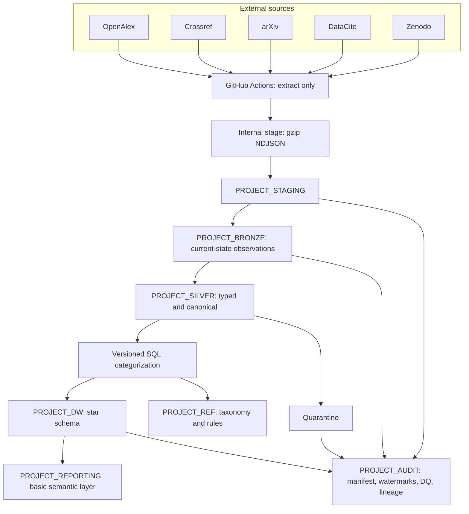

# Architecture and Naming Standard

## Single source of truth
Database: `PAPERSONAR`. Schemas: `PROJECT_STAGING`, `PROJECT_BRONZE`, `PROJECT_SILVER`, `PROJECT_DW`, `PROJECT_REPORTING`, `PROJECT_AUDIT`, `PROJECT_REF`. Use unquoted uppercase identifiers. Do not introduce alternative names without updating this file and all dependent specs.

## Architecture

## Naming
- Staging: `STG_<SOURCE>_<ENTITY>` (e.g. `STG_OPENALEX_WORK`)
- Bronze: `BRZ_<SOURCE>_<ENTITY>`
- Silver: `SLV_<ENTITY>`
- Dimensions: `DIM_<ENTITY>`
- Facts: `FACT_<ENTITY>`
- Bridges: `BRIDGE_<ENTITY>`
- Reference: `REF_<ENTITY>`
- Audit: `BATCH_MANIFEST`, `SOURCE_WATERMARK`, `RUN_LOG`, `DQ_RESULT`, `SCHEMA_DRIFT_LOG`
- Surrogate key: `<ENTITY>_KEY`; batch: `BATCH_ID`; hash: `RECORD_HASH`; current SCD2 row: `IS_CURRENT`.
- SQL directories: `00_setup`, `01_staging`, `02_bronze`, `03_silver`, `04_categorization`, `05_dimensions`, `06_facts`, `07_reporting`, `08_audit_dq`, `09_tasks`, `99_tests`.

## Layer contracts
**Staging:** explicit `VARIANT` payload plus filename, row number, batch ID, loaded timestamp. No transformations and no schema inference.
**Bronze:** current-state observations with source/entity/source record ID/batch/window/hash/checksum/ingestion time/file. MERGE on source, entity, and source record ID updates the existing row in place. File-level history remains in the raw stage, manifest and lineage tables.
**Silver:** typed, standardized, deduplicated records, canonical identity/crosswalk, provenance, and quarantine reason codes.
**DW:** Kimball star schema; all dimensions have numeric surrogate keys and unknown/not-applicable members. Fact joins resolve business keys to surrogate keys.
**Reporting:** business-named views and controlled publication. No Phase 3 analytics.

## Source observations vs canonical outputs
One output may appear in several sources. Preserve each source observation in bronze; map source identifiers to a canonical output in silver; retain attribute provenance. Do not sum source counts as unique output counts. DOI is preferred where available, not universal. Matching fallbacks are versioned and auditable.

## Naming compatibility
Before altering a Phase 1 name, inspect the data dictionary, record the reason, and update all dependencies. Preserve Phase 1 artifacts. Snowflake is the chosen platform; PostgreSQL concepts are mapped to Snowflake equivalents, not implemented as PostgreSQL-specific features.

## References
- Snowflake identifiers: https://docs.snowflake.com/en/sql-reference/identifiers-syntax
- Snowflake constraints: https://docs.snowflake.com/en/sql-reference/constraints
- Micro-partitions and clustering: https://docs.snowflake.com/en/user-guide/tables-clustering-micropartitions
