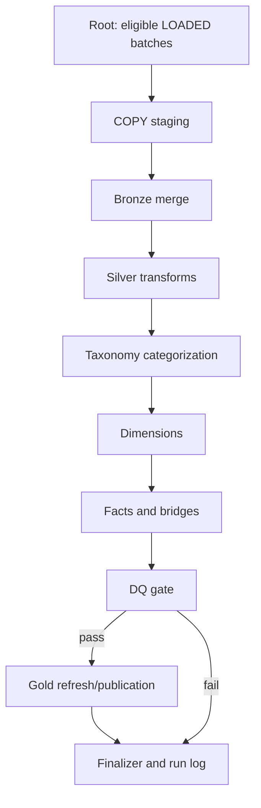

# Snowflake Task-Graph Orchestration

## Binding decision
All transformations run inside Snowflake through the `PAPERSONAR.PROJECT_AUDIT.TASK_ELT_*` graph. GitHub Actions extracts, uploads, and is the only scheduler: it calls the Snowflake root with `python -m runner.cli trigger --drain` after all source batches are `LOADED`. The Snowflake root has no `SCHEDULE`; it runs only via `EXECUTE TASK`. SQL objects are deployed from the internal `SQL_STAGE` with `EXECUTE IMMEDIATE FROM`; each task calls its stage procedure directly (for example, `SP_RUN_STAGE('FACTS')`). No Git repository stage is required.

`VERIFY:` the exact syntax and privilege model for internal-stage `PUT` plus `EXECUTE IMMEDIATE FROM`, and confirm `EXECUTE TASK` for the loader role. Official docs: https://docs.snowflake.com/en/sql-reference/sql/execute-immediate-from and https://docs.snowflake.com/en/sql-reference/sql/execute-task.

## Graph

Use separate tasks or clearly logged stages for each node. Finalizer must run after success or failure through a design that does not accidentally publish failed data. A downstream failure must be visible in audit and alerting; never rely on a task's existence as proof it ran.

## Root eligibility
Only batches with status `LOADED` are eligible. Claim a batch safely before processing so overlapping roots do not process it concurrently. A claim lease/heartbeat or equivalent recovery design must handle abandoned processing. Root execution must be safe when no eligible batch exists.

## Task definitions
Dependencies are explicit with `AFTER`; the root has no Snowflake `SCHEDULE`. GitHub owns freshness via its 01:00 UTC cron, and `trigger --drain` calls the root once per loaded batch. Do not add a second Snowflake cron or schedule sources independently inside Snowflake.

Every task records run ID, batch ID, start/end, query ID if available, row counts, status, and error details. Configure bounded retries where supported and `SUSPEND_TASK_AFTER_NUM_FAILURES` appropriately. `VERIFY:` exact task parameter names, retry semantics, and graph finalizer patterns. Root `EXECUTE TASK` on a suspended root is supported for a user-managed warehouse: https://docs.snowflake.com/en/sql-reference/sql/execute-task.

## SQL execution model
`sql/09_tasks/02_task_graph.sql` creates the root, eight child tasks and the finalizer with `CREATE OR REPLACE TASK`. Stage procedures read the active batch from `PROJECT_AUDIT.CURRENT_BATCH`; no untrusted value is concatenated into task definitions. SQL files are version-controlled as plain text; only raw data files are gzip-compressed.

## Staging alternative
Default: task runs `COPY INTO` staging from internal stage. This keeps loading and transformation in Snowflake's controlled graph and avoids separate GitHub warehouse commands per file. Alternative: Python issues COPY statements after upload. It may reduce orchestration complexity but increases the number of client-controlled steps and makes the batch lifecycle less centralized. Both incur Snowflake load/compute/storage effects; measure rather than claiming a universal credit saving.

## Warehouse choice
Default: user-managed XS warehouse with 60-second auto-suspend. Serverless tasks are an alternative only if trial availability and credit behavior are verified. Record task duration and credit use. Set statement timeouts and bounded retry behavior. Avoid infinite retry loops.

## Failure and recovery
- COPY fails: leave batch non-published; inspect file format, manifest, and COPY history; retry safely.
- Bronze fails: replay idempotent MERGE; do not advance watermark prematurely.
- Silver fails: replay affected batch; preserve quarantine and error logs.
- Dimension/fact fails: rerun only after checking key stability and transaction boundaries.
- DQ fails: keep batch unpublished; retain DQ results and fix/retry.
- Gold fails: do not expose batch as published; retry gold refresh then finalizer.
- Finalizer fails: reconcile actual table state and manifest before retrying.

## Deploy and resume
`CREATE OR REPLACE TASK` recreates tasks in `suspended` state. `runner.cli deploy` and `deploy-ci.yml` therefore prepare the graph immediately after `sql/09_tasks/02_task_graph.sql` is applied:

1. `ALTER TASK PAPERSONAR.PROJECT_AUDIT.TASK_ELT_ROOT SUSPEND`
2. `ALTER TASK` ... `RESUME` for every child task
3. Leave the root suspended. Snowflake requires `SCHEDULE`, `AFTER`, `FINALIZE`, or `WHEN` before a task can be resumed, and the root intentionally has none.

Children are resumed so a GitHub `EXECUTE TASK` can never fire into a graph with suspended children. `EXECUTE TASK` runs a suspended root without resuming it. Manual child resume remains available for incident response.

`VERIFY:` confirm `CREATE OR REPLACE TASK` semantics, child/finalizer dependency preservation, and that `EXECUTE TASK` can run a suspended root: https://docs.snowflake.com/en/sql-reference/sql/create-task and https://docs.snowflake.com/en/sql-reference/sql/execute-task.

## Pause
Disable GitHub cron and suspend/disable root and child tasks using supported task controls. Suspend warehouse when safe. Verify graph-wide suspension behavior in the account.

## Rejected alternatives
- Snowpipe: not selected because explicit batch manifests and controlled graph execution are central to reproducible academic acceptance; evaluate only if ingestion latency becomes a requirement.
- Python UDF/external access: rejected because the trial is assumed not to support the required outbound API access and transformations must remain SQL-first.
- dbt: not selected to keep dependencies and deployment complexity small; SQL files and Snowflake execution are the required baseline.
- Airflow: rejected as unnecessary extra orchestration infrastructure for a small student project with GitHub Actions plus Snowflake tasks.

## Acceptance
- Root ignores batches not LOADED.
- All dependencies and retry rules are documented.
- Failure blocks publication.
- Finalizer logs failures.
- Re-running a stage is safe.
- GitHub Actions is the only scheduler; the Snowflake root has no cron schedule.
- Internal-stage deploy and automatic task-graph resume are tested live.
- Task history proves the full graph ran.

## References
- Snowflake task graphs: https://docs.snowflake.com/en/user-guide/tasks-graphs
- CREATE TASK: https://docs.snowflake.com/en/sql-reference/sql/create-task
- EXECUTE TASK: https://docs.snowflake.com/en/sql-reference/sql/execute-task
- EXECUTE IMMEDIATE FROM: https://docs.snowflake.com/en/sql-reference/sql/execute-immediate-from
