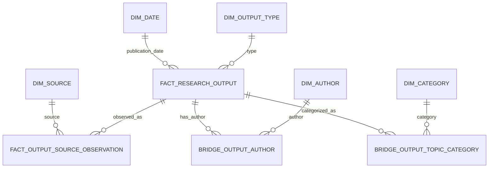

# Dimensional Model and Data Warehouse

## Source of truth
Inspect the Phase 1 data dictionary before finalizing fields. Record conflicts in `14_ISSUES_RISKS_RESOLUTIONS.md`. The default model below is a baseline and must be reconciled to the existing project design.

## Facts and grain
- `FACT_RESEARCH_OUTPUT`: one row per canonical research output. Measures may include current source-specific citation observations only if clearly named; do not sum across duplicate source observations.
- `FACT_CITATION_SNAPSHOT`: one row per canonical output, source, and snapshot date (or another explicit grain agreed in the dictionary). Citation count is a periodic snapshot measure, generally non-additive across time.
- `FACT_OUTPUT_SOURCE_OBSERVATION`: one row per source observation of a canonical output.
- `BRIDGE_OUTPUT_AUTHOR`: output-author relationship, with contribution/order metadata where available.
- `BRIDGE_OUTPUT_TOPIC_CATEGORY`: output-category relationship, score, confidence, primary flag, taxonomy version.
- `FACT_OUTPUT_RELATION`: one row per directed relation between canonical outputs, with relation type and source provenance.
- Add a factless relationship bridge only when a concrete business relationship exists in the Phase 1 model.

## Conformed dimensions
`DIM_DATE` (role-playing), `DIM_SOURCE`, `DIM_OUTPUT_TYPE`, `DIM_VENUE`, `DIM_AUTHOR`, `DIM_INSTITUTION`, `DIM_TOPIC`, `DIM_CATEGORY`, `DIM_ACCESS_STATUS`, `DIM_LANGUAGE`, `DIM_COUNTRY`.

Every dimension requires a numeric surrogate key, business key, hash diff, audit columns, and explicit unknown/not-applicable members. Use reserved keys `0` and `-1` consistently for Unknown and Not Applicable, subject to verified data type and key policy. Do not generate these values from the normal sequence.

## Surrogate keys and stability
Use a Snowflake sequence or identity/autoincrement strategy after verifying concurrency and insert behavior. Business key is the MERGE match key; surrogate key is assigned once and remains stable. Sequence gaps are expected and must not be treated as missing data.

Illustrative example:
| Business key | First load | Rerun |
|---|---:|---:|
| `OPENALEX:A123` | `OUTPUT_KEY=1001` | `OUTPUT_KEY=1001` |
| `CROSSREF:10.x/abc` | maps to same canonical output where identity is proven | unchanged |
Never assume the exact numeric values are contiguous or predictable.

## SCD policy
- Type 1: overwrite nonhistorical attributes when history is irrelevant.
- Type 2: author/affiliation, venue, and topic where history matters; use effective dates, `IS_CURRENT`, version, and hash diff.
- Type 3 or mini-dimension: only if a documented attribute needs limited previous/current tracking.

Two-step SCD2 pattern:
1. Detect changed current rows by business key and `HASH_DIFF`; expire old rows by setting `EFFECTIVE_TO`, `IS_CURRENT=FALSE`.
2. Insert new versions for new or changed business keys with new surrogate keys, `EFFECTIVE_FROM`, open-ended `EFFECTIVE_TO`, `IS_CURRENT=TRUE`, incremented version, and hash diff.

Ensure source deduplication before MERGE and handle concurrent runs. Use a transaction where supported and tested; otherwise use a controlled batch claim and recovery reconciliation. Do not let two concurrent runs create two current versions.

## Fact loading
Join silver business keys to dimension business keys and then use surrogate keys. For SCD2 dimensions, perform a point-in-time join using the fact's relevant event date between effective bounds. If a dimension is missing, create a documented inferred member or route the fact to quarantine; never silently drop the fact. Deferred updates must be auditable.

MERGE facts on their declared grain key. Snapshot facts use insert-by-date with `NOT EXISTS` or an equivalent idempotent key. Bridge weights should sum to the declared rule (for example, category confidence weights only if that is the chosen semantic contract).

## Constraints
Declare primary/foreign keys only as useful metadata. Snowflake standard-table constraints are generally not enforced for uniqueness/referential integrity; enforce through DQ SQL.
`VERIFY:` current Snowflake constraint behavior and table-type exceptions.

## ER diagram

## Acceptance
- DDL lists every dimension/fact/bridge column and type.
- All dimensions have stable surrogate keys and unknown members.
- SCD2 has exactly one current row per business key.
- Fact grain is unique.
- Fact loading uses surrogate-key joins.
- No orphan dimension references.
- At least 100 dimension rows and 10,000 fact rows are evidenced.
- Reruns do not alter existing surrogate-key assignments.

## References
- Snowflake sequences: https://docs.snowflake.com/en/sql-reference/sql/create-sequence
- Snowflake MERGE: https://docs.snowflake.com/en/sql-reference/sql/merge
- Snowflake constraints: https://docs.snowflake.com/en/sql-reference/constraints
- Kimball dimensional modeling: https://www.kimballgroup.com/data-warehouse-business-intelligence-resources/
