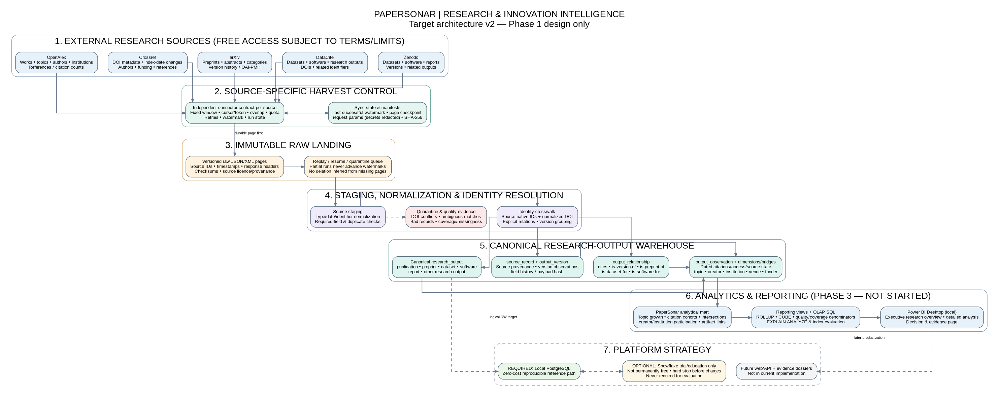
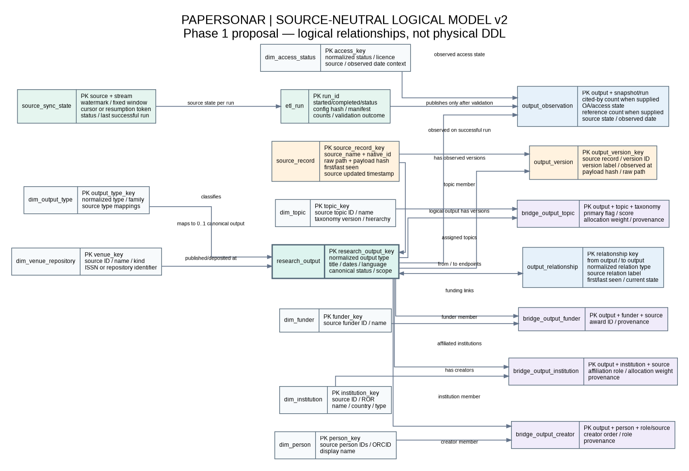

# PaperSonar target architecture v2

**State:** Phase 1 target design. Phase 2 ETL and Phase 3 analytics have not started. This architecture is intentionally tailored to PaperSonar rather than copied from a retail-sales example.

## Architecture image

## Source-neutral logical model

- [Logical model PNG](diagrams/08_Logical_research_output_model_v2.png)
- [Logical model PDF](diagrams/08_Logical_research_output_model_v2.pdf)
- [Editable logical model DOT](diagrams/08_Logical_research_output_model_v2.dot)

**Legacy note:** diagrams `01` through `06`, `papersonar.dbml`, `model-design.docx/pdf`, and the original 15-table/89-field dictionary describe the earlier publication-centered design. They are retained as historical reference and must not be treated as the final physical model for the expanded five-source scope.

- [PNG](diagrams/07_Target_architecture_v2.png)
- [PDF](diagrams/07_Target_architecture_v2.pdf)
- [SVG source](diagrams/07_Target_architecture_v2.svg)
- [Editable Graphviz source](diagrams/07_Target_architecture_v2.dot)

## Design layers

1. **Source systems:** OpenAlex, Crossref, arXiv, DataCite, and Zenodo. They overlap and do not share a common identity model.
2. **Source-specific ingestion contracts:** independent cursor/date/OAI-PMH strategy, quota controls, watermarks, overlap windows, retry and checkpoint rules.
3. **Immutable raw landing:** page-level JSON/XML, response metadata, checksums, manifests, source-native IDs and extraction windows. Raw evidence is preserved before transformation.
4. **Staging / validation:** parse and normalize records, validate identifiers and dates, quarantine malformed or conflicting records, measure missingness and detect changed payload hashes.
5. **Identity and relationship resolution:** source-record crosswalk, DOI normalization, explicit relation mapping, arXiv version tracking, and manual quarantine for ambiguous matches. Never use title-only automatic merging.
6. **Canonical research-output warehouse:** one common output entity for publication, preprint, dataset, software, report, and other research objects; separate source records and version observations; typed relationships; dimensions for dates, output type, topic, person, institution, venue, funder and access; dated metric observations; and citation/related-output relationships.
7. **Analytics mart:** PaperSonar-specific facts and bridges for publication activity, dated citation observations, topic intersections, institutional contribution, research artifacts and output-to-output relationships. Grain and counting rules remain explicit.
8. **Reporting and evidence:** PostgreSQL reporting views, SQL OLAP queries, local Power BI Desktop, evidence exports with corpus version, source cutoffs, observation date, metric version, coverage and caveats.
9. **Future product:** optional read-only API and web UI for saved direction comparisons and evidence dossiers. Not part of Phase 1 implementation.

## Free-first deployment and Snowflake

- **Reference implementation target:** local PostgreSQL, Python, open-source libraries, local files, Git, Draw.io/Graphviz and Power BI Desktop. This path must remain usable without any paid cloud service.
- **Snowflake compatibility:** keep warehouse naming and transformations portable where reasonable, document PostgreSQL/Snowflake SQL differences, and avoid using Snowflake-only features in the core model. A later optional adapter can map the same logical layers to Snowflake.
- **Cost guard:** Snowflake is not assumed to be permanently free. Use it only if a no-cost trial/educational credit is actually available, with alerts and a hard stop before charges. The project must not require Snowflake to pass evaluation or reproduce results.
- **Storage separation:** raw files stay outside database tables where possible; warehouse stores normalized analytical records and pointers/checksums. Do not mirror all raw JSON into both PostgreSQL and Snowflake by default.

## Proposed source-neutral logical entities

| Entity | Grain / purpose |
|---|---|
| `research_output` | One canonical logical research output, irrespective of source. |
| `source_record` | One source-native record for one source identifier. |
| `output_version` | One observed/versioned representation of a research output. |
| `output_relationship` | One directed, typed relationship between two outputs (citation, version, dataset/software relation, preprint/published relation). |
| `output_observation` | One canonical output × successful observation run, for time-varying fields such as citation count, OA state and source update date. |
| `bridge_output_topic` | One canonical output × topic assignment, including source, score, primary flag and allocation weight. |
| `bridge_output_creator` | One output × creator/person identifier, preserving author/creator order and source attribution. |
| `bridge_output_institution` | One output × affiliated institution with allocation rules and provenance. |
| `etl_run` / `source_sync_state` | Pipeline provenance and independent per-source watermarks/checkpoints. |

The existing publication-centered 15-table design is retained as a useful first analytical mart, but it is not sufficient by itself to represent all five sources. Phase 1 must explicitly revise the conceptual/logical model and dictionary before Phase 2. Do not silently force datasets/software into a publication-only fact.

## Failure and recovery rules

- A source connector has its own run state, watermark and quota budget.
- Every raw page is durable before its cursor/token is committed.
- Partial windows can be resumed; watermarks advance only after a complete, validated window.
- Changed records are appended to source history and upserted into the active canonical representation.
- DOI conflicts and ambiguous entity matches are quarantined, not auto-merged.
- A missing record is not a deletion until complete reconciliation confirms the state.
- A warehouse snapshot is published only after all required source partitions for that snapshot have passed validation.

## Course alignment

- Phase 1: business process identification, 10+ questions, grains, fact types, dimensions/hierarchies, natural and surrogate keys, conceptual/logical/physical models, data dictionary and source register.
- Phase 2 (future): source files/API pages → `project_staging` → `project_dw` → `project_reporting`, 100+ dimension records, 10,000+ fact records, surrogate-key mapping, cleaning and data-quality reports.
- Phase 3 (future): PaperSonar analytical SQL, `ROLLUP`, `CUBE`, reporting views, `EXPLAIN ANALYZE` before/after indexes, local Power BI pages, screenshots, business insights and presentation.

Retail examples such as revenue and customer orders are not copied. PaperSonar's equivalent measures concern research outputs, citations, topic intersections, creators, institutions, access, versions and relationships.
